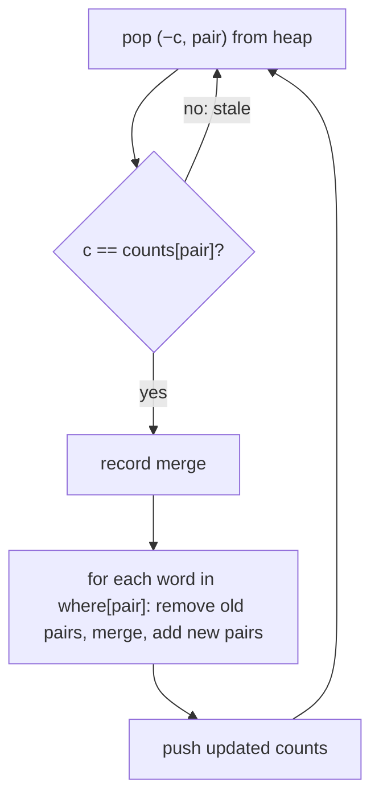

#### The idea
The simple loop recounts every pair after every merge, but a merge of `(a, b)` only changes the words that contain
`a b`. So keep, across merges:

- `counts[pair]`: the weighted count of every pair;
- `where[pair]`: the ids of words that contain it;
- a heap of `(-count, pair)` to find the best pair quickly.

A merge then touches only the words in `where[(a, b)]`: subtract their old pairs, rewrite them, add their new pairs, and
push the changed counts onto the heap. Old heap entries are not removed; when one is popped and its count no longer
matches `counts`, skip it (lazy deletion).



#### A solution
```python
import heapq
from collections import Counter, defaultdict


def solve(text, num_merges):
    word_freq = Counter(text.split())
    words = [list(w) for w in word_freq]
    freqs = list(word_freq.values())
    counts = defaultdict(int)
    where = defaultdict(set)
    for wid, symbols in enumerate(words):
        for pair in zip(symbols, symbols[1:]):
            counts[pair] += freqs[wid]
            where[pair].add(wid)
    heap = [(-c, p) for p, c in counts.items()]
    heapq.heapify(heap)

    merges = []
    while len(merges) < num_merges and heap:
        neg, pair = heapq.heappop(heap)
        if neg == 0 or counts.get(pair, 0) != -neg:
            continue                                    # stale entry
        merges.append(pair)
        a, b = pair
        changed = set()
        for wid in list(where[pair]):
            symbols, freq = words[wid], freqs[wid]
            for old in zip(symbols, symbols[1:]):       # remove this word's old pairs
                counts[old] -= freq
                changed.add(old)
            out, i = [], 0
            while i < len(symbols):                     # merge left to right, no overlap
                if i + 1 < len(symbols) and symbols[i] == a and symbols[i + 1] == b:
                    out.append(a + b)
                    i += 2
                else:
                    out.append(symbols[i])
                    i += 1
            words[wid] = out
            for old in set(zip(symbols, symbols[1:])):
                where[old].discard(wid)
            for new in zip(out, out[1:]):               # add the new pairs
                counts[new] += freq
                where[new].add(wid)
                changed.add(new)
        for p in changed:
            if counts[p] > 0:
                heapq.heappush(heap, (-counts[p], p))
    return merges
```

#### What it costs
Each merge costs time proportional to the words that contain the pair, plus `O(log H)` per heap push. Early merges
(`e s`, `t h`) touch many words; most of the 2,000 merges touch a handful, so the whole run is about half a second
against tens of seconds for the recount loop. The heap grows by one entry per changed count; stale entries are cheap
to skip. Fast tokenizer trainers (Hugging Face `tokenizers`, written in Rust) use the same incremental idea.

#### Pitfalls
- Recomputing all pair counts each merge: correct, and about 100 times too slow for the benchmark.
- Trusting the heap's top without checking it against `counts` (stale entries win otherwise).
- Removing a word from `where[old]` but not decrementing its count, or doing both twice for a pair that occurs twice
  in one word (the code subtracts per occurrence and discards per distinct pair).
- Tie-breaking by anything other than `(-count, pair)`; the heap's tuple order does it for free.
