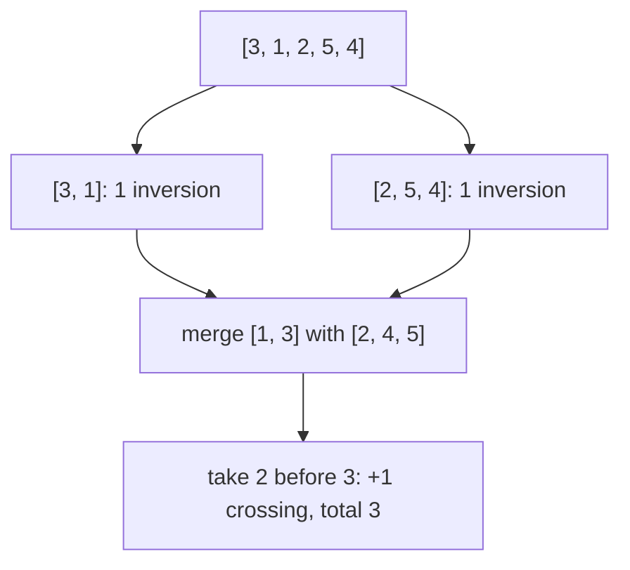

#### The idea
Merge sort counts inversions for free. When merging two sorted halves, every time an element from the **right** half
is taken before the remaining elements of the left half, it is smaller than all of them: that adds
`len(left) − i` inversions in one step.



The alternative is a Fenwick tree over value ranks: scan from the right, and for each value add how many smaller values
have been seen.

#### A solution
```python
def solve(nums):
    a = list(nums)
    buf = [0] * len(a)
    total = 0
    width = 1
    while width < len(a):                      # bottom-up merge sort: no recursion limit to worry about
        for lo in range(0, len(a), 2 * width):
            mid, hi = min(lo + width, len(a)), min(lo + 2 * width, len(a))
            i, j, k = lo, mid, lo
            while i < mid and j < hi:
                if a[i] <= a[j]:               # <= keeps equal values from counting
                    buf[k] = a[i]; i += 1
                else:
                    buf[k] = a[j]; j += 1
                    total += mid - i           # a[j] is smaller than every remaining left element
                k += 1
            buf[k:k + mid - i] = a[i:mid]
            k += mid - i
            buf[k:k + hi - j] = a[j:hi]
            a[lo:hi] = buf[lo:hi]
        width *= 2
    return total
```

#### What it costs
`O(n log n)` time and `O(n)` extra memory. In C++ the same merge sort runs in a few milliseconds for 200,000 values;
keep `total` in `long long`, since the count can reach `n(n−1)/2 ≈ 2·10¹⁰`. In Python, the Fenwick version
(`O(n log n)` after coordinate compression) is a similar speed; `sorted()`-based tricks with `bisect.insort` are
`O(n²)` in the worst case because of list insertion.

#### Pitfalls
- Taking from the right on ties (`<` instead of `<=`), which counts equal pairs as inversions.
- An `int` counter in C++.
- Recursive merge sort with list slicing in Python: correct, but the copies make it slow; bottom-up with one buffer is
  faster.
