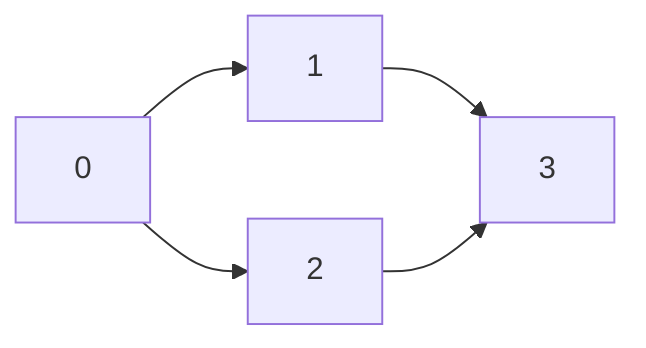

#### The idea
Kahn's algorithm peels the graph from the sources inward. A course is **ready** when all its prerequisites are taken,
which is when its in-degree reaches 0. Taking a course removes its outgoing edges; any course whose in-degree drops to
0 becomes ready. With the ready set in a min-heap, every step takes the smallest ready label, which is the
lexicographically smallest order.



Ready `{0}` → take 0 → ready `{1, 2}` → take 1 → ready `{2}` → take 2 → ready `{3}` → take 3. A cycle shows up as
courses whose in-degree never reaches 0: the loop ends with fewer than `n` courses taken.

#### A solution
```python
import heapq


def solve(n, prerequisites):
    after = [[] for _ in range(n)]    # after[b]: courses that need b
    waiting = [0] * n                 # unfinished prerequisites per course
    for a, b in prerequisites:
        after[b].append(a)
        waiting[a] += 1
    ready = [c for c in range(n) if waiting[c] == 0]
    heapq.heapify(ready)
    order = []
    while ready:
        c = heapq.heappop(ready)
        order.append(c)
        for d in after[c]:
            waiting[d] -= 1
            if waiting[d] == 0:
                heapq.heappush(ready, d)
    return order if len(order) == n else []
```

#### What it costs
`O((n + m) log n)` with the heap; a plain queue makes it `O(n + m)` but returns some valid order rather than the
smallest. DFS with three colours (unvisited, on the stack, done) also detects cycles and gives a reverse postorder.
Build systems (make, Bazel), spreadsheet recalculation, and ML frameworks (scheduling ops in a compute graph, or
pipeline stages) all run a topological sort.

#### Pitfalls
- Reversing the edge direction: `[a, b]` means `b` comes **first**.
- Deduplicating repeated pairs in the adjacency list but not in the in-degree (or the reverse), which leaves a course
  waiting forever.
- Returning a partial order instead of `[]` when there is a cycle.
- Recursive DFS in Python on a 100,000-node chain: `RecursionError`.
