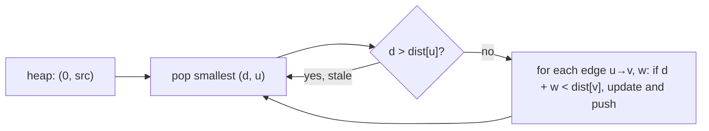

#### The idea
Process nodes in order of their final distance. A min-heap holds `(distance, node)` candidates. Pop the smallest; if it
is stale (a shorter distance was already found), skip it; otherwise relax its outgoing edges, pushing any improved
neighbour. With non-negative weights, the first time a node is popped its distance is final, because every other path
to it would go through a node at least as far away.



#### A solution
```python
import heapq


def solve(n, edges, src):
    graph = [[] for _ in range(n)]
    for u, v, w in edges:
        graph[u].append((v, w))
    INF = float("inf")
    dist = [INF] * n
    dist[src] = 0
    heap = [(0, src)]
    while heap:
        d, u = heapq.heappop(heap)
        if d > dist[u]:
            continue                       # stale entry: u was already settled closer
        for v, w in graph[u]:
            nd = d + w
            if nd < dist[v]:
                dist[v] = nd
                heapq.heappush(heap, (nd, v))
    return [-1 if d == INF else d for d in dist]
```

#### What it costs
`O((n + m) log m)` with this lazy-deletion heap: each edge pushes at most one entry. A decrease-key heap (Fibonacci) is
`O(m + n log n)` in theory and slower in practice. Zero-weight and 0/1 graphs can use a deque (0-1 BFS); negative
weights need Bellman-Ford. In C++, `priority_queue<pair<long long,int>, vector<...>, greater<>>` and an adjacency list
in CSR form (offsets plus one flat edge array) is the fast version; keep distances in `long long`.

#### Pitfalls
- Marking a node visited when it is **pushed** instead of when it is popped: the first path found is not always the
  shortest (the "trap" test).
- Not skipping stale heap entries, which re-relaxes edges and can blow up the running time.
- Building the graph as an adjacency matrix: `O(n²)` memory for 100,000 nodes.
- Treating the graph as undirected.
