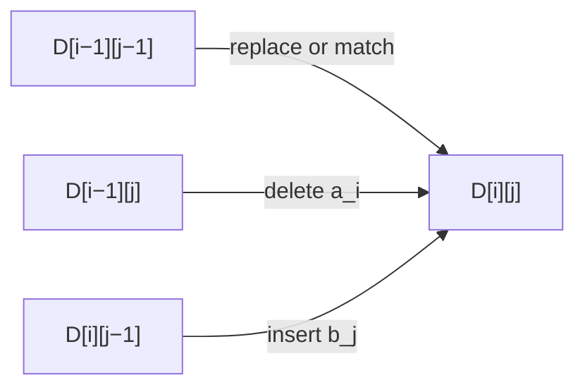

#### The idea
Let `D[i][j]` be the distance between the first `i` characters of `a` and the first `j` of `b`. The last step of the
best edit sequence is a delete, an insert, or a replace (free when the characters match):

$$D[i][j] = \min\big(D[i-1][j] + 1,\; D[i][j-1] + 1,\; D[i-1][j-1] + [a_i \ne b_j]\big)$$

with `D[i][0] = i` and `D[0][j] = j`. Each row depends only on the row above, so keep two rows.



#### A solution
```python
def solve(a, b):
    if len(a) < len(b):
        a, b = b, a                        # keep the rolling row over the shorter string
    prev = list(range(len(b) + 1))
    for i, ca in enumerate(a, 1):
        cur = [i] + [0] * len(b)
        for j, cb in enumerate(b, 1):
            cur[j] = min(prev[j] + 1, cur[j - 1] + 1, prev[j - 1] + (ca != cb))
        prev = cur
    return prev[-1]
```

Edit distance is symmetric, so swapping the strings does not change the answer.

#### What it costs
`O(n·m)` time and `O(min(n, m))` memory. For two 2,000-character strings that is 4 million cell updates, about half a
second in plain Python, so the tight inner loop matters. When the distance is known to be at most `d`, only a diagonal band of
width `2d + 1` matters (`O(n·d)`), and Myers' bit-parallel algorithm does 64 cells per machine word. Recovering the
actual edits needs the full table or Hirschberg's divide and conquer.

#### Pitfalls
- Off-by-one between string indices and table indices (`a[i-1]` against `D[i]`).
- Forgetting the base row and column (`D[i][0] = i`).
- Memoised recursion in Python: 4 million frames of overhead and the recursion limit.
- Copying the whole row with `prev = cur[:]` inside the inner loop instead of once per row.
