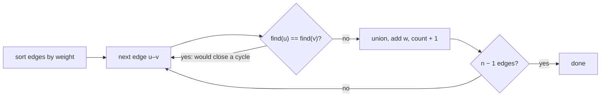

#### The idea
**Cut property:** split the nodes into any two groups; the lightest edge crossing between them belongs to some minimum
spanning tree (swap it in for any heavier crossing edge and the tree only gets lighter). Kruskal applies this over and
over: scan edges from lightest to heaviest and keep each one that joins two different components. Each kept edge is
the lightest edge leaving its component, so every choice is safe.



#### A solution
```python
def solve(n, edges):
    parent = list(range(n))
    size = [1] * n

    def find(x):
        while parent[x] != x:
            parent[x] = parent[parent[x]]
            x = parent[x]
        return x

    total = taken = 0
    for u, v, w in sorted(edges, key=lambda e: e[2]):
        ru, rv = find(u), find(v)
        if ru == rv:
            continue                      # same component: skip (self-loops land here too)
        if size[ru] < size[rv]:
            ru, rv = rv, ru
        parent[rv] = ru
        size[ru] += size[rv]
        total += w
        taken += 1
        if taken == n - 1:
            break
    return total if taken == n - 1 else -1
```

#### What it costs
`O(m log m)` for the sort, then `O(m·α(n))` for the union-find work. Prim's algorithm with a heap is
`O(m log n)` and suits dense graphs or an adjacency list you already have. MSTs show up in clustering (single-linkage
clustering is Kruskal stopped early at `k` components), network design, and approximation algorithms for the
travelling salesman problem.

#### Pitfalls
- Returning the weight of a spanning **forest** when the graph is disconnected.
- Forgetting that weights can be negative: the tree still has `n − 1` edges, you do not take every negative edge.
- Treating `n = 1` as disconnected (zero edges are needed).
- Sorting with the default tuple order, which works, but `key=` on the weight avoids comparing node ids.
