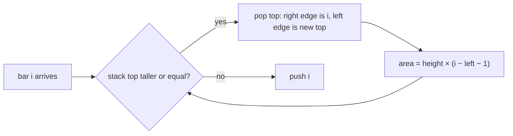

#### The idea
Every candidate rectangle is limited by its lowest bar. For bar `i` of height `h`, the widest rectangle of height `h`
runs from just after the nearest lower bar on the left to just before the nearest lower bar on the right. A stack of
indices with increasing heights finds both boundaries at the moment a bar is popped:



A sentinel bar of height 0 at the end flushes the stack, so every bar is popped once.

#### A solution
```python
def solve(heights):
    stack = []                       # indices; heights increase from bottom to top
    best = 0
    for i, h in enumerate(list(heights) + [0]):
        while stack and heights[stack[-1]] >= h:
            top = heights[stack.pop()]
            left = stack[-1] if stack else -1
            best = max(best, top * (i - left - 1))
        stack.append(i)
    return best
```

Popping on `>=` handles equal heights: the earlier equal bar is popped with a narrower width, and the last one of the
run gets the full width, which is the one that counts.

#### What it costs
`O(n)` time, since each index is pushed and popped once, and `O(n)` for the stack. Divide and conquer around the minimum
is `O(n log n)` on average and `O(n²)` on sorted input. The same stack solves "next greater element", stock spans,
trapping rain water, and the "maximal rectangle of 1s in a binary matrix" (run this on each row's column heights).

#### Pitfalls
- Forgetting the sentinel, so bars still on the stack at the end are never measured.
- Width `i − left` instead of `i − left − 1`.
- Using the popped index as the left boundary instead of the index **below** it on the stack.
- Mutating the input by appending the sentinel to `heights` itself.
