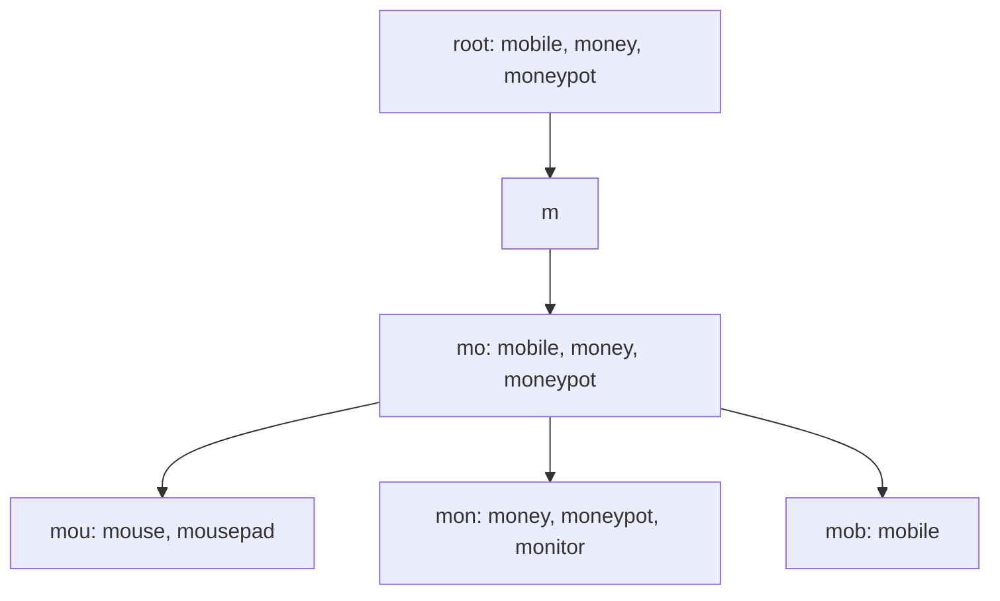

#### The idea
In sorted order, every word that starts with a prefix `p` lies in one contiguous block, and that block begins exactly
where `p` would be inserted: any word `≥ p` that starts with `p` comes before any word `≥ p` that does not. So sort the
distinct words once, `bisect_left` each prefix, and read forward at most three words.

A trie gives the same answers by walking one node per character. Storing the three smallest words at each node during
the build makes each query `O(len(prefix))`.



#### A solution
```python
import bisect


def solve(words, prefixes):
    vocab = sorted(set(words))
    out = []
    for prefix in prefixes:
        i = bisect.bisect_left(vocab, prefix)
        found = []
        while i < len(vocab) and len(found) < 3 and vocab[i].startswith(prefix):
            found.append(vocab[i])
            i += 1
        out.append(found)
    return out
```

#### What it costs
Sorting is `O(W log W)` string comparisons; each query is `O(log W)` comparisons plus three `startswith` checks.
The trie with cached top-3 lists costs `O(total characters)` to build and memory, and `O(len(prefix))` per query, so it
wins when the dictionary is fixed and the queries never stop. Real autocomplete ranks by popularity rather than
alphabet: each trie node keeps the top-k by score, which also works for weighted suggestions.

#### Pitfalls
- Scanning the whole dictionary per query: `10¹⁰` checks for the benchmark.
- Forgetting to deduplicate, so `"bee"` is suggested three times.
- `bisect_right` instead of `bisect_left`, which skips a word equal to the prefix.
- Special-casing the empty prefix as "no match": every word starts with `""`, and `bisect_left` already returns 0.
