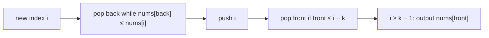

#### The idea
Keep a deque of **indices** whose values are decreasing from front to back. The front is always the window's maximum.

- When a new value arrives, pop from the back every index whose value is `<=` the new one: those can never be a maximum
  again, because the new value is at least as large and stays in the window longer.
- Pop from the front when its index has slid out of the window.



#### A solution
```python
from collections import deque


def solve(nums, k):
    window = deque()  # indices; their values decrease from front to back
    out = []
    for i, x in enumerate(nums):
        while window and nums[window[-1]] <= x:
            window.pop()
        window.append(i)
        if window[0] <= i - k:
            window.popleft()
        if i >= k - 1:
            out.append(nums[window[0]])
    return out
```

#### What it costs
`O(n)` time: every index is pushed once and popped at most once, so the inner `while` loops add up to `n` iterations in
total. `O(k)` memory for the deque. A heap with lazy deletion is `O(n log n)` and a sparse table `O(n log n)` memory;
both are slower here. In C++, `std::deque<int>` works; a plain `vector<int>` with head and tail indices is faster.

#### Pitfalls
- Storing values instead of indices, so you cannot tell when the front has left the window.
- Popping with `<` instead of `<=`: still correct, but the deque keeps duplicates and does more work.
- Calling `max(nums[i - k + 1 : i + 1])` for each position: `O(n·k)`, about 10⁹ steps for the benchmark.
