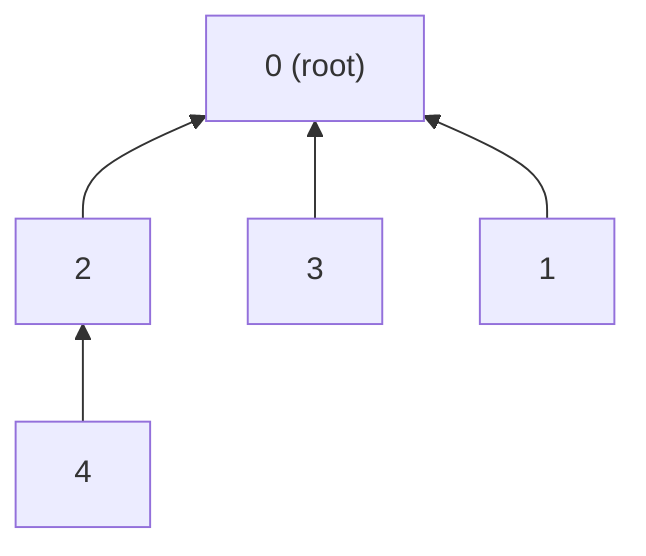

#### The idea
Each group is a tree; its root names the group. `find` walks to the root, `union` hangs one root under the other. Two
small rules keep the trees almost flat:

- **Union by size:** hang the smaller tree under the larger, so a node's depth grows only when its tree at least
  doubles. Depth stays `O(log n)`.
- **Path compression:** after a `find`, point the nodes on the path closer to the root. The version below uses path
  halving (each node skips to its grandparent), which needs no recursion and no second pass.



After `find(4)` with path halving, `4` points to `0` directly.

#### A solution
```python
def solve(n, ops):
    parent = list(range(n))
    size = [1] * n

    def find(x):
        while parent[x] != x:
            parent[x] = parent[parent[x]]  # path halving
            x = parent[x]
        return x

    answers = []
    for op, a, b in ops:
        ra, rb = find(a), find(b)
        if op == "same":
            answers.append(ra == rb)
        elif ra != rb:
            if size[ra] < size[rb]:
                ra, rb = rb, ra
            parent[rb] = ra               # smaller tree under the larger
            size[ra] += size[rb]
    return answers
```

#### What it costs
With both rules, `m` operations take `O(m·α(n))`, where `α` is the inverse Ackermann function, at most 4 for any `n`
you will meet. Without either rule, the benchmark's chain of unions makes each `find` `O(n)`: about `3·10¹⁰` steps.
Union-find is the engine of Kruskal's minimum spanning tree, connected components in a stream, and percolation.

#### Pitfalls
- A recursive `find` in Python on a deep tree: `RecursionError` before compression has a chance to help.
- Linking `parent[a] = b` instead of linking the **roots**.
- Union by size without updating the size of the new root.
