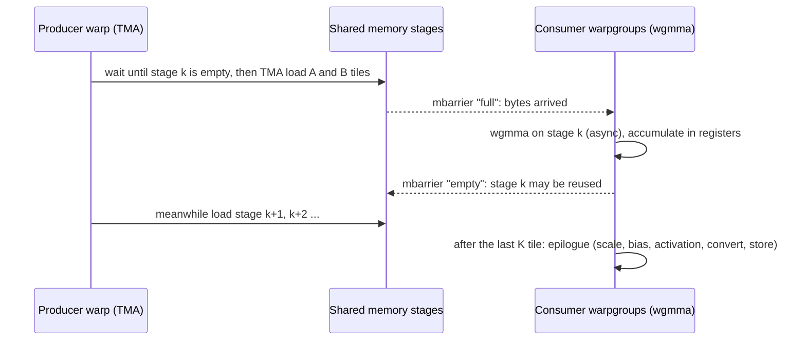

# Lesson: what changed from Volta to Blackwell

Since 2017 almost all of a data-center GPU's FLOPs come from **Tensor Cores**: units that compute a small matrix
multiply-accumulate `D = A × B + C` in one instruction. Each generation made them bigger, fed them with lower-precision
numbers, and added hardware to keep them fed. To write fast kernels today you need to know what each generation added.

| Generation | Example | Compute capability | Tensor Cores | Also new for kernel writers |
|---|---|---|---|---|
| Volta (2017) | V100 | 7.0 | 1st gen: FP16 in, FP32 accumulate; `wmma` API | independent thread scheduling |
| Turing (2018) | T4 | 7.5 | INT8, INT4 | |
| Ampere (2020) | A100 | 8.0 | TF32, BF16, FP64; 2:4 sparsity; `mma.sync` | `cp.async` (global → shared without registers), 40 MB L2 |
| Ada (2022) | RTX 4090 | 8.9 | FP8 | |
| Hopper (2022) | H100, H200 | 9.0 | FP8; `wgmma`: a warpgroup (4 warps), operands read from shared memory, asynchronous | **TMA**, **thread block clusters**, distributed shared memory, transaction barriers |
| Blackwell (2024) | B200, GB200 | 10.0 | FP6, FP4, block-scaled formats; `tcgen05.mma` issued by one thread, accumulators in **Tensor Memory**; 2-SM MMA | two dies as one GPU, NVLink 5 |
| Blackwell consumer | RTX 50 series | 12.0 | FP4 and FP6 with `mma.sync`-style warp instructions (no Tensor Memory) | |

### Tensor Cores, from warp to block

<figure class="diagram"><svg viewBox="0 0 660 200" width="660" role="img" aria-label="Who issues a Tensor Core instruction on Ampere, Hopper and Blackwell">
<rect x="10" y="20" width="200" height="160" rx="8" class="d-fill"/>
<text x="110" y="40" class="d-text d-bold" text-anchor="middle">Ampere: mma.sync</text>
<rect x="30" y="54" width="160" height="30" rx="4" class="d-a"/><text x="110" y="73" class="d-muted" text-anchor="middle">1 warp, 32 threads</text>
<text x="110" y="104" class="d-muted" text-anchor="middle">operands in registers</text>
<text x="110" y="120" class="d-muted" text-anchor="middle">tile m16 n8 k16</text>
<text x="110" y="136" class="d-muted" text-anchor="middle">synchronous</text>
<rect x="230" y="20" width="200" height="160" rx="8" class="d-fill"/>
<text x="330" y="40" class="d-text d-bold" text-anchor="middle">Hopper: wgmma</text>
<rect x="250" y="54" width="36" height="30" rx="4" class="d-a"/><rect x="290" y="54" width="36" height="30" rx="4" class="d-a"/>
<rect x="330" y="54" width="36" height="30" rx="4" class="d-a"/><rect x="370" y="54" width="36" height="30" rx="4" class="d-a"/>
<text x="330" y="104" class="d-muted" text-anchor="middle">warpgroup: 4 warps, 128 threads</text>
<text x="330" y="120" class="d-muted" text-anchor="middle">A, B from shared memory</text>
<text x="330" y="136" class="d-muted" text-anchor="middle">tile m64 n up to 256 k16</text>
<text x="330" y="152" class="d-muted" text-anchor="middle">asynchronous (wait later)</text>
<rect x="450" y="20" width="200" height="160" rx="8" class="d-fill"/>
<text x="550" y="40" class="d-text d-bold" text-anchor="middle">Blackwell: tcgen05.mma</text>
<rect x="530" y="54" width="40" height="30" rx="4" class="d-b"/><text x="550" y="73" class="d-muted" text-anchor="middle">1 thread</text>
<text x="550" y="104" class="d-muted" text-anchor="middle">A, B from shared memory</text>
<text x="550" y="120" class="d-muted" text-anchor="middle">D in Tensor Memory (TMEM)</text>
<text x="550" y="136" class="d-muted" text-anchor="middle">tile up to m128 (m256 on 2 SMs)</text>
<text x="550" y="152" class="d-muted" text-anchor="middle">asynchronous</text>
</svg>
<figcaption>Each generation issues bigger matrix tiles with fewer threads, so that the rest of the SM is free to move data. On Blackwell the accumulator no longer occupies registers at all.</figcaption></figure>

You rarely write these instructions by hand; CUTLASS, cuBLAS, Triton and ThunderKittens do. But their shapes explain
why GEMM dimensions should be multiples of 64 or 128, and why a tiny matrix (one token in a decode step) wastes most of a
Tensor Core instruction.

### TMA: the Tensor Memory Accelerator (Hopper+)

Before Hopper, every thread computed addresses and issued its own loads to fill a shared-memory tile. With **TMA**, one
thread hands the hardware a *tensor map* (shape, strides, tile size, swizzle; built on the host with
`cuTensorMapEncodeTiled`) and the coordinates of a tile. The TMA unit copies the whole tile from global to shared
memory (or back), handles out-of-bounds elements, applies a swizzle that avoids bank conflicts, and can **multicast**
the tile to several blocks of a cluster. Completion is signalled on an **mbarrier**: the consumer waits until the
barrier has seen the expected number of bytes.

### Thread block clusters and distributed shared memory (Hopper+)

A **cluster** is a group of blocks (up to 8 portably, 16 on H100 with an opt-in) that the hardware guarantees to run
at the same time on neighbouring SMs. Blocks of a cluster can read and write each other's shared memory
(**distributed shared memory**, `cluster.map_shared_rank`) and synchronize with `cluster.sync()`. GEMM kernels use
clusters so that one TMA load of a tile of A is multicast to all the blocks that need it, cutting L2 traffic.

### Warp specialization: a producer–consumer pipeline



Hopper GEMMs and FlashAttention-3 split a block's warps into roles: a **producer** warp only issues TMA loads into a
ring of shared-memory stages; **consumer** warpgroups only issue `wgmma`. Barriers hand stages back and forth, so
memory and math overlap fully. The producer needs few registers, so it gives them up (`setmaxnreg`) to the consumers.
On Blackwell the MMA is issued by one thread and the accumulator lives in **Tensor Memory** (256 KB per SM), so even
the epilogue (reading the accumulator out of TMEM) can overlap with the next tile's math.

### Low precision: FP8, FP6, FP4 and block scaling

Halving the bits of an operand doubles Tensor Core throughput and halves memory traffic. The catch is range and
precision. Compare the formats on one value:

```widget
formats value=3.14159
```

- **FP8 E4M3** (max 448) has more precision, used for weights and activations; **E5M2** (max 57,344) has more range,
  used for gradients. Hopper uses one FP32 scale per tensor (NVIDIA's Transformer Engine tracks the maximum to choose it).
- **FP4 E2M1** has only 16 values: ±{0, 0.5, 1, 1.5, 2, 3, 4, 6}. It works only with a scale per small **block** of
  values. **MXFP4** (an OCP standard) uses one power-of-two (E8M0) scale per 32 values; **NVFP4** uses one FP8 E4M3
  scale per 16 values plus a per-tensor FP32 scale. Blackwell's Tensor Cores apply these block scales in hardware.

```widget
block-scale outlier=20 scheme=nvfp4
```

Push the outlier up and switch between the three schemes: with one scale for everything, a single large value crushes
the rest to zero; small blocks contain the damage to their own 16 values.

### Where to go next
- GPU gym: [FP16 GEMM with Tensor Cores](#/gym/gpu/gemm_fp16) and [int8 matvec](#/gym/gpu/int8_matvec) run on any
  Tensor Core GPU.
- [Outperforming cuBLAS on H100](https://cudaforfun.substack.com/p/outperforming-cublas-on-h100-a-worklog) builds a
  Hopper GEMM with TMA, wgmma, clusters and warp specialization, step by step.
- The CUDA C++ Programming Guide sections on *thread block clusters*, *asynchronous data copies* and *TMA*.
