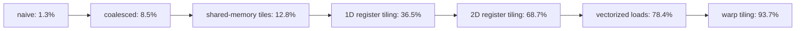

# Lesson: one kernel, many versions

Optimization is a ladder: each rung removes the current bottleneck and exposes the next. Here are two classic ladders.

### Row softmax, 4096 columns in FP32

`y[i, j] = exp(x[i, j] − max_i) / Σ_k exp(x[i, k] − max_i)`. Each row is read and written; the ideal traffic is 8 bytes
per element, so the roofline says: memory-bound, time = bytes / bandwidth.

| Version | What changed | DRAM traffic per element | Bottleneck next |
|---|---|---|---|
| 1. Three kernels (max, sum, normalize) | | ~20 B (x read three times, temporaries) | extra passes over memory |
| 2. One block per row, shared-memory reductions | fused into one kernel | 8 B | many `__syncthreads()`, idle threads |
| 3. Warp shuffles for the reductions | fewer barriers, no shared memory traffic | 8 B | scalar loads, latency |
| 4. `float4` loads, several values per thread in registers | more bytes per instruction, more loads in flight | 8 B | at 85–90% of bandwidth: done |
| 5. Online softmax (running max and sum in one pass) | row read once even when it does not fit on chip | 8 B | the basis of FlashAttention |

The jump from 1 to 2 is fusion (traffic), 2 to 4 is latency hiding (occupancy and instruction-level parallelism). Once a
memory-bound kernel reaches ~90% of bandwidth, it is finished: only moving fewer bytes (BF16 instead of FP32, fusing with
the neighbouring op) can make it faster.

### SGEMM, from naive to near cuBLAS

Simon Boehm's worklog measured these steps for a 4096² FP32 GEMM on an RTX A6000 (percent of cuBLAS):

Each rung raises arithmetic intensity at one level of the hierarchy: coalescing uses DRAM sectors fully, shared-memory
tiles reuse data across a block, register tiles reuse it within a thread, warp tiles match the hardware's scheduling
unit. On Hopper and Blackwell, the next rungs are Tensor Cores (`wgmma`, `tcgen05`), TMA with a multistage pipeline,
warp specialization, clusters with multicast, and a persistent tile scheduler: what CUTLASS and cuBLAS do.

### A checklist for any kernel

1. Write the reference and a test. Decide the tolerance (FP32: ~1e-5 relative; BF16: ~1e-2).
2. Compute the roofline bound: minimum bytes and FLOPs. That is your target.
3. Make global accesses coalesced and vectorized; keep reused data in shared memory or registers.
4. Check occupancy and spills (`-Xptxas -v`, Nsight Compute); give each thread enough independent work.
5. Remove barriers and bank conflicts; use warp shuffles inside a warp.
6. Use Tensor Cores for anything matrix-shaped, through a library if you can.
7. Fuse with neighbours to cut traffic; measure after every step.

Then go do it: the GPU gym benchmarks your kernel against your GPU's limits and PyTorch.
