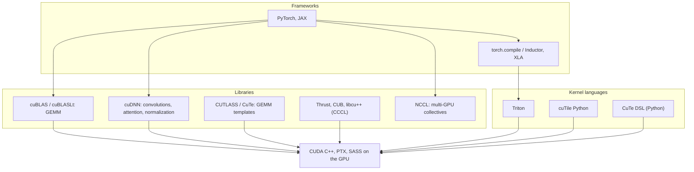

# Lesson: don't write what a library already does

Hand-written CUDA is for the kernels nobody has written yet. For everything else there is a library tuned for each
GPU generation, and knowing the stack saves weeks.



### cuBLAS and cuBLASLt: matrix multiply

`cublasGemmEx` and friends compute `C = α·op(A)·op(B) + β·C` in any precision, choosing a kernel for your GPU.
**cuBLASLt** adds FP8 and block-scaled FP4 inputs, and **epilogues**: bias, ReLU/GELU, and scaling fused into the GEMM's
final store, saving a full pass over C. Batched (`cublasGemmStridedBatched`) and grouped GEMMs cover attention heads
and mixture-of-experts.

> [!WARNING]
> cuBLAS uses **column-major** storage (Fortran order). A row-major matrix read as column-major is its transpose. To get
> row-major `C = A·B`, ask cuBLAS for `Cᵀ = Bᵀ·Aᵀ`: pass `B` first, then `A`, and swap `M` and `N`. No copy needed.

### cuDNN: deep-learning primitives

Convolutions, normalization, and since cuDNN 9 fused **scaled dot-product attention** (flash-attention style) for
Hopper and Blackwell, through a graph API: you describe a small graph (matmul → scale → softmax → matmul) and cuDNN
picks or generates a fused kernel. PyTorch's `scaled_dot_product_attention` can dispatch to it.

### CUTLASS and CuTe: GEMM building blocks

**CUTLASS** is NVIDIA's open-source C++ template library for GEMM and convolution at every level: thread, warp,
warpgroup, block, cluster. It exposes the newest hardware first (TMA, `wgmma`, `tcgen05`, block-scaled FP4) and lets you
write your own **epilogue** fusions. CUTLASS 3 is built on **CuTe**, whose central idea is the **layout**: a pair
*shape : stride* that maps logical coordinates to memory offsets.

- `(4, 2) : (1, 4)` is a 4 × 2 column-major matrix: element `(i, j)` is at `i + 4j`.
- `(4, 2) : (2, 1)` is the same shape row-major: `(i, j)` is at `2i + j`.
- Shapes nest: `(2, (2, 2)) : (4, (1, 2))` describes a tiled or swizzled arrangement with the same algebra.

Layouts compose, divide into tiles and partition over threads, which is how one CuTe kernel describes what every thread
copies and multiplies. **CuTe DSL** (CUTLASS 4) brings the same model to Python, JIT-compiled.

### Thrust, CUB and libcu++ (CCCL)

**Thrust** is the STL for GPUs: `thrust::device_vector`, `sort`, `reduce`, `transform`, `inclusive_scan`, `copy_if`,
with algorithms that dispatch to the GPU. **CUB** is the layer below: device-wide algorithms (`cub::DeviceReduce`,
`DeviceRadixSort`, `DeviceScan` with decoupled look-back) and block- and warp-level collectives you call inside your own
kernels (`cub::BlockReduce`, `cub::WarpScan`, `cub::BlockLoad`). **libcu++** gives standard C++ (`cuda::std::atomic`,
`cuda::barrier`, `cuda::memcpy_async`). They ship together as CCCL with the CUDA toolkit.

```cuda
#include <cub/cub.cuh>
__global__ void row_sum(const float* x, float* out, int cols) {
    using Reduce = cub::BlockReduce<float, 256>;
    __shared__ typename Reduce::TempStorage tmp;
    float v = 0;
    for (int j = threadIdx.x; j < cols; j += 256) v += x[blockIdx.x * cols + j];
    float total = Reduce(tmp).Sum(v);          // shuffles + shared memory, tuned per architecture
    if (threadIdx.x == 0) out[blockIdx.x] = total;
}
```

### Triton and cuTile: programming blocks, not threads

In **Triton** you write a Python function for one *program instance* (like a block) that operates on whole tiles:
`tl.load` a block of pointers with a mask, compute with `tl.dot` and `tl.sum`, `tl.store`. The compiler handles
coalescing, shared memory, Tensor Cores and software pipelining. `torch.compile` generates Triton kernels for fused
elementwise and reduction ops.

```python
@triton.jit
def add(x_ptr, y_ptr, out_ptr, n, BLOCK: tl.constexpr):
    pid = tl.program_id(0)
    offs = pid * BLOCK + tl.arange(0, BLOCK)
    mask = offs < n
    tl.store(out_ptr + offs, tl.load(x_ptr + offs, mask=mask) + tl.load(y_ptr + offs, mask=mask), mask=mask)
```

NVIDIA's **cuTile** (CUDA 13.1 and later, with the CUDA Tile IR) is a tile-based model in the same spirit, from NVIDIA
itself: you write array operations on tiles in Python and the compiler maps them to Tensor Cores and TMA.

### Your kernel inside PyTorch

1. Write the kernel and a C++ function that checks inputs (`TORCH_CHECK(x.is_cuda())`, contiguity, dtype), allocates
   the output and launches on the current stream (`at::cuda::getCurrentCUDAStream()`).
2. Register it as an operator with `TORCH_LIBRARY` (or `torch.library.custom_op` from Python, which also works for
   Triton kernels), so it works with autograd, `torch.compile` and `torch.export`.
3. Build with `torch.utils.cpp_extension` (`load_inline` for experiments, `setup.py` for a package).
4. Add a fake (meta) implementation so `torch.compile` can trace shapes, and test with `torch.library.opcheck` and
   `torch.testing.assert_close` against a reference.

### NCCL

Multi-GPU work (data, tensor and pipeline parallelism) runs on **NCCL** collectives (all-reduce, all-gather,
reduce-scatter) over NVLink and InfiniBand. Learn its costs before you write your own.

### Where to go next
- GPU gym: every exercise accepts **Triton** as well as CUDA; try [row softmax](#/gym/gpu/row_softmax) and
  [matmul](#/gym/gpu/matmul) in Triton, then compare with your CUDA.
- The LLM gym's PyTorch exercises (such as [RMSNorm](#/gym/llm/rms_norm)) are where a custom op would plug in.
