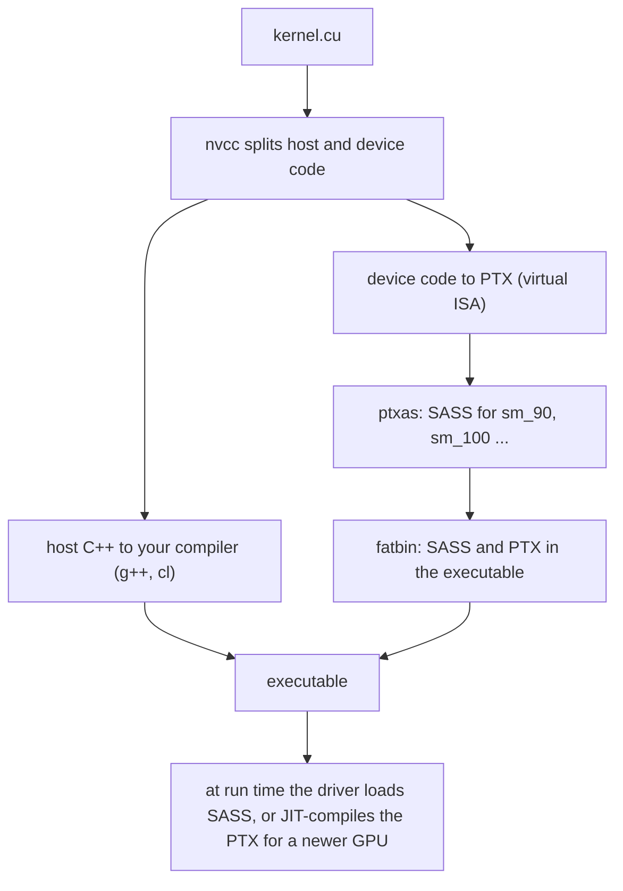

# Lesson: the CUDA programming model

A CPU core is built to finish *one* thread as fast as possible: big caches, branch prediction, out-of-order execution.
A GPU is built to finish *a huge number* of threads per second. It spends its transistors on arithmetic units and
registers instead, and it hides the long wait for memory by always having other threads ready to run.

<figure class="diagram"><svg viewBox="0 0 640 210" width="640" role="img" aria-label="A CPU with a few big cores beside a GPU with many small cores">
<rect x="10" y="10" width="250" height="170" rx="8" class="d-fill"/>
<text x="135" y="30" class="d-text d-bold" text-anchor="middle">CPU: few fast cores</text>
<rect x="24" y="42" width="100" height="58" rx="5" class="d-a"/>
<text x="74" y="76" class="d-muted" text-anchor="middle">core + control</text>
<rect x="146" y="42" width="100" height="58" rx="5" class="d-a"/>
<text x="196" y="76" class="d-muted" text-anchor="middle">core + control</text>
<rect x="24" y="110" width="222" height="56" rx="5" class="d-c"/>
<text x="135" y="143" class="d-muted" text-anchor="middle">large caches</text>
<rect x="300" y="10" width="330" height="170" rx="8" class="d-fill"/>
<text x="465" y="30" class="d-text d-bold" text-anchor="middle">GPU: many simple cores in SMs</text>
<rect x="314" y="42" width="70" height="56" rx="4" class="d-b"/><text x="349" y="74" class="d-muted" text-anchor="middle">SM</text>
<rect x="392" y="42" width="70" height="56" rx="4" class="d-b"/><text x="427" y="74" class="d-muted" text-anchor="middle">SM</text>
<rect x="470" y="42" width="70" height="56" rx="4" class="d-b"/><text x="505" y="74" class="d-muted" text-anchor="middle">SM</text>
<rect x="548" y="42" width="70" height="56" rx="4" class="d-b"/><text x="583" y="74" class="d-muted" text-anchor="middle">SM</text>
<rect x="314" y="104" width="70" height="30" rx="4" class="d-b"/><rect x="392" y="104" width="70" height="30" rx="4" class="d-b"/>
<rect x="470" y="104" width="70" height="30" rx="4" class="d-b"/><rect x="548" y="104" width="70" height="30" rx="4" class="d-b"/>
<rect x="314" y="140" width="304" height="26" rx="4" class="d-c"/>
<text x="466" y="158" class="d-muted" text-anchor="middle">L2 cache, then HBM: terabytes per second</text>
<text x="135" y="200" class="d-muted" text-anchor="middle">optimised for latency: one thread, fast</text>
<text x="465" y="200" class="d-muted" text-anchor="middle">optimised for throughput: 100 000+ threads in flight</text>
</svg>
<figcaption>An H100 has 132 SMs (streaming multiprocessors); each keeps up to 2048 threads resident. A desktop CPU has 8 to 32 cores running a thread or two each.</figcaption></figure>

### Host and device

A CUDA program runs on the **host** (the CPU) and launches work on the **device** (the GPU). They have separate
memories, so the program copies data over, launches a **kernel**, and copies the result back:

```cuda
__global__ void saxpy(int n, float a, const float* x, float* y) {  // runs on the GPU
    int i = blockIdx.x * blockDim.x + threadIdx.x;  // which element is mine?
    if (i < n) y[i] = a * x[i] + y[i];              // the grid is rounded up: check
}

int main() {
    int n = 1 << 20;
    float *x, *y;
    cudaMalloc(&x, n * sizeof(float));                        // device memory
    cudaMalloc(&y, n * sizeof(float));
    cudaMemcpy(x, hx, n * sizeof(float), cudaMemcpyHostToDevice);
    cudaMemcpy(y, hy, n * sizeof(float), cudaMemcpyHostToDevice);
    int block = 256, grid = (n + block - 1) / block;          // round up
    saxpy<<<grid, block>>>(n, 2.0f, x, y);                    // asynchronous: returns at once
    cudaError_t err = cudaGetLastError();                     // a bad launch configuration shows here
    cudaMemcpy(hy, y, n * sizeof(float), cudaMemcpyDeviceToHost);  // waits for the kernel
    cudaFree(x); cudaFree(y);
}
```

- `__global__` marks a kernel: called from the host, runs on the device. `__device__` functions are called from
  kernels; `__host__ __device__` compiles for both.
- `<<<grid, block>>>` launches **grid × block** threads. Threads are grouped into **blocks** (up to 1024 threads);
  blocks form the **grid**. Both can be 1D, 2D or 3D (`dim3`).
- Each thread reads `threadIdx` (its position in the block), `blockIdx` (its block's position in the grid),
  `blockDim` and `gridDim`. From them it computes which data it owns.
- Launches are **asynchronous**. Errors in the kernel show up at the next synchronizing call, so check
  `cudaGetLastError()` after a launch and the result of `cudaDeviceSynchronize()` when debugging.

### Find your element

Move the sliders: change the grid and block sizes, then point at a thread to see the index it computes. Make `n`
bigger than the grid to see elements nobody handles, then switch to a **grid-stride loop**, which lets a fixed-size
grid cover any `n`.

```widget
thread-index blocks=3 threads=8 n=20
```

For a 2D problem such as an image, use a 2D block and grid. Each thread computes a row and a column:

```cuda
dim3 block(16, 16);
dim3 grid((width + 15) / 16, (height + 15) / 16);
// in the kernel:
int col = blockIdx.x * blockDim.x + threadIdx.x;
int row = blockIdx.y * blockDim.y + threadIdx.y;
if (row < height && col < width) out[row * width + col] = f(in[row * width + col]);
```

> [!TIP]
> Put `x` on the fastest-changing index (the column of a row-major array). Neighbouring threads then touch neighbouring
> addresses, which is what the memory system rewards (the memory track explains why).

### From source to GPU



`nvcc -arch=sm_90` builds for Hopper. **PTX** is a portable virtual instruction set; **SASS** is the real machine code
of one generation. Shipping PTX lets the driver compile for GPUs that did not exist when you built. Some features
need an architecture-specific target: Hopper's `wgmma` needs `sm_90a`, Blackwell's `tcgen05` needs `sm_100a`.

### Where to go next
- The questions below check the indexing arithmetic.
- In the GPU gym, write [the playground](#/gym/gpu/playground), [vector add](#/gym/gpu/vector_add),
  [SAXPY](#/gym/gpu/saxpy) and [ReLU](#/gym/gpu/relu) in CUDA on a real GPU.
