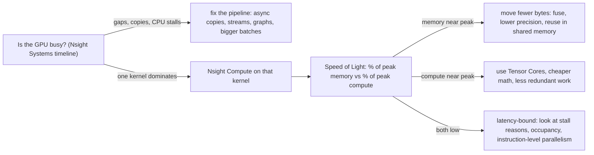

# Lesson: roofline, Nsight, streams and graphs

### The roofline

Every kernel moves bytes and does arithmetic. Its **arithmetic intensity** is FLOPs per byte of DRAM traffic. A GPU
can do at most `peak FLOP/s`, and at most `bandwidth × intensity` FLOP/s when it is waiting on memory. The lower of the
two is the **roofline**; where they meet is the **ridge point**. An H100 has 3.35 TB/s and 989 dense BF16 TFLOP/s, so
its ridge is near 295 FLOP/byte: a kernel needs ~300 FLOPs per byte loaded before Tensor Cores become the limit.

```widget
roofline gpu=h100 precision=bf16 kernel=gemm n=12
```

Try a vector add (0.08 FLOP/byte): it is memory-bound on every GPU, by a factor of thousands. Decode-time
matrix-vector products are memory-bound too, which is why LLM decoding speed tracks HBM bandwidth. Large GEMMs are
compute-bound. Switching the GPU from H100 to B200 moves the roof up *and* to the right: bandwidth grew less than FLOPs,
so more kernels become memory-bound on newer GPUs.

### Measure, don't guess: the Nsight tools



- **Nsight Systems** (`nsys profile ./app`) shows a timeline of the whole program: CPU threads, CUDA API calls, kernels,
  memory copies, NCCL. Use it first, to find gaps and the kernels worth optimizing.
- **Nsight Compute** (`ncu --set full -k mykernel ./app`) replays one kernel and reports hundreds of metrics: achieved
  memory throughput and FLOP rate as a percentage of peak ("Speed of Light"), cache hit rates, achieved occupancy,
  **warp stall reasons** (waiting on memory: *long scoreboard*; on a barrier: *barrier*; on shared memory: *MIO
  throttle*…), and source-level hot spots.
- Time kernels with CUDA events (`cudaEventRecord` before and after, `cudaEventElapsedTime`), after a warm-up run.
  CPU timers around an asynchronous launch measure the launch, not the kernel.

### Streams: overlap copies and compute

Work in one **stream** runs in order; work in different streams may overlap. GPUs have separate copy engines, so a
copy in one stream can run while a kernel from another stream computes. Split a big job into chunks, one stream each:

```widget
streams chunks=4 engines=2 h2d=8 kernel=8 d2h=8
```

The host buffers must be **pinned** (`cudaMallocHost`) for `cudaMemcpyAsync` to be truly asynchronous. **Events**
(`cudaEventRecord`, `cudaStreamWaitEvent`) express dependencies between streams without blocking the CPU.

### Launch overhead and CUDA Graphs

Each kernel launch costs a few microseconds of CPU and GPU time. For a model that runs hundreds of small kernels per
step (LLM decoding with a small batch), launch overhead can dominate. A **CUDA Graph** records a sequence of kernels and
copies once (stream capture) and replays it with a single launch. PyTorch exposes it as `torch.cuda.graphs` and
`torch.compile(mode="reduce-overhead")`.

### Fusion

A chain like `y = gelu(x * w + b)` written as three kernels reads and writes the full tensor three times. Fused into one
kernel, it reads `x` once and writes `y` once: three times less traffic for a memory-bound op. Fusion is the reason
FlashAttention, fused RMSNorm and `torch.compile` exist.

### Where to go next
- In the GPU gym, run `gpu-gym bench <exercise>`: every exercise reports your kernel against the GPU's bandwidth or
  FLOP/s and against PyTorch.
- [Nsight Compute's kernel profiling guide](https://docs.nvidia.com/nsight-compute/ProfilingGuide/) explains every
  metric and stall reason.
