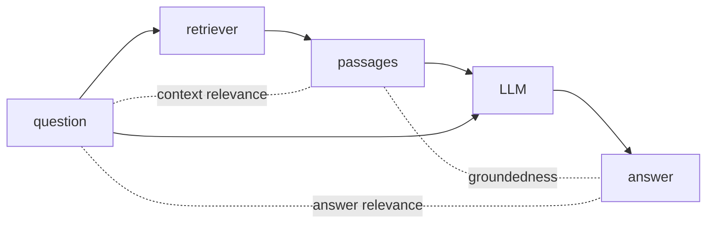

# Evaluating LLMs and retrieval

**Retrieval metrics** judge the ranked list a search returns for one query, then average over queries:

- **Recall@k**: the fraction of all relevant documents that appear in the top $k$. In RAG it matters most: if the answer isn't retrieved, the model can't use it.
- **Precision@k**: the fraction of the top $k$ that is relevant.
- **MRR** (mean reciprocal rank): $1 / \text{rank}$ of the *first* relevant result, averaged. Good when one right answer is enough.
- **nDCG@k**: graded relevance with a log discount by position, $\text{DCG} = \sum_{i=1}^{k} \frac{rel_i}{\log_2(i + 1)}$, divided by the DCG of the ideal order so it lies in $[0, 1]$.

**The RAG triad** evaluates a retrieval-augmented answer in three parts, so you know which component failed:

1. **Context relevance**: did retrieval bring back passages that bear on the question?
2. **Groundedness** (faithfulness): is every claim in the answer supported by those passages?
3. **Answer relevance**: does the answer address the question that was asked?

*The RAG triad scores the three dotted links separately. A wrong answer with relevant passages is a generation failure; irrelevant passages point at retrieval.*

**Evaluating generated text:**

| Approach | Good for | Weakness |
|---|---|---|
| Exact match, unit tests, verifiers | math, code, extraction | only where a checker exists |
| Overlap metrics (BLEU, ROUGE) | translation, summaries with references | reward wording, not meaning |
| LLM-as-judge with a rubric | open-ended quality at scale | biased toward length, position and its own style; calibrate it against human labels |
| Human evaluation, pairwise preference (Elo) | the final word on helpfulness | slow and expensive |

Public **benchmarks** (MMLU, GSM8K, HumanEval, SWE-bench, …) compare models, but they saturate and can leak into training data. For a product, build a small evaluation set from real traffic, with the failure cases you care about, and rerun it on every change.
