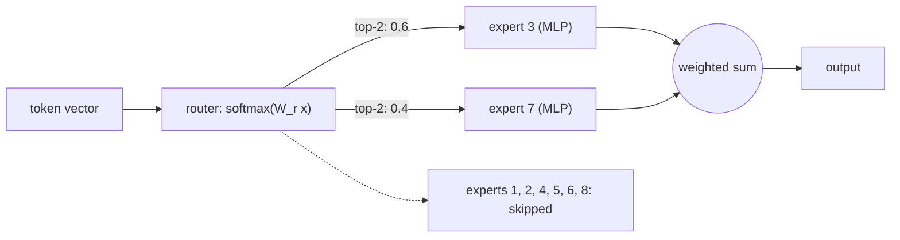

# Experts, tokenizers and scaling laws

**Mixture of experts (MoE).** The MLP in some or all blocks is replaced by $E$ expert MLPs and a **router**. For each token, the router scores the experts, keeps the top $k$ (often 1, 2 or 8 of dozens or hundreds), and combines their outputs weighted by the softmax of the kept scores. The model has the *parameters* of all experts but each token pays the *compute* of only $k$: **total** versus **active** parameters. Mixtral 8x7B has about 47B total and 13B active.

*Top-2 routing in one MoE layer. Every expert's weights must sit in memory, but each token pays the compute of only two, which is why MoE models list total and active parameters separately.*

Routing needs two guards:

- **Load balance.** Left alone, the router sends most tokens to a few experts. An auxiliary loss pushes the fraction of tokens each expert receives toward uniform (some recent models adjust a per-expert bias instead).
- **Capacity.** Each expert processes at most $C = \text{capacity factor} \times k \times \frac{\text{tokens}}{E}$ tokens per batch; tokens beyond that are dropped (they pass through the residual connection) or rerouted.

**Tokenization.** **Byte-pair encoding** starts from single symbols and repeatedly merges the most frequent adjacent pair into a new token until the vocabulary reaches its target size. **Byte-level** BPE starts from the 256 byte values, so any string, in any language or with emoji, can be encoded without an unknown token. A larger vocabulary shortens sequences but grows the embedding and output matrices. Tokenization explains many oddities: arithmetic on numbers split into odd chunks, counting letters in a word the model sees as one token, and cost differences between languages.

**Scaling laws.** Loss falls as a smooth power law in parameters $N$ and training tokens $D$. Training compute is about $C \approx 6ND$ FLOPs. The **Chinchilla** result: for a fixed compute budget, the loss-optimal choice grows $N$ and $D$ together, about **20 tokens per parameter**. Models meant to serve many users are trained on far more tokens than that (Llama 3 8B saw about 15T tokens), since a smaller model trained longer is cheaper to run.
