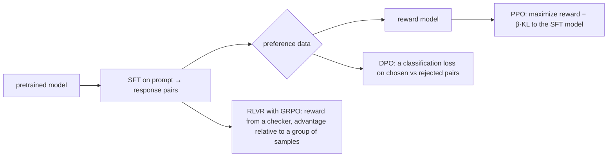

# From a pretrained model to an assistant

A pretrained model continues text. **Post-training** makes it follow instructions, be helpful and safe, and reason better.

1. **Supervised fine-tuning (SFT).** Train on prompt-response pairs with the usual next-token loss, counting only the response tokens. Cheap and effective; the model imitates the demonstrations, including their mistakes.
2. **Preference optimization.** Collect pairs of responses where a person (or a model) marked one as better.
   - **RLHF with PPO:** train a **reward model** on the pairs (it scores a response), then optimize the policy with PPO to maximize reward minus a KL penalty that keeps it close to the SFT model. Powerful but heavy: the policy, a reference model, a reward model and a value model (critic) all in memory, and tricky to tune.
   - **DPO** skips the reward model and RL loop. It shows that the optimal policy for that KL-regularized objective satisfies a simple relation, and trains directly on preference pairs with a classification-style loss:
   $$\mathcal{L} = -\log \sigma\Big(\beta \big[\log \tfrac{\pi(y_w|x)}{\pi_\text{ref}(y_w|x)} - \log \tfrac{\pi(y_l|x)}{\pi_\text{ref}(y_l|x)}\big]\Big).$$
   Simple and stable, but offline: it learns only from the pairs it is given.
3. **Reinforcement learning from verifiable rewards (RLVR).** For math, code and other tasks with a checker, the reward is whether the answer is right (tests pass). No reward model to hack. This is how reasoning models are trained to think longer.
   - **GRPO** (from DeepSeekMath) samples a group of responses per prompt and uses each response's reward relative to the group's mean (divided by the standard deviation) as its advantage. No critic network is needed, which saves memory and removes a source of error. DAPO and similar variants adjust its clipping, sampling and length handling.

*The usual post-training routes. SFT comes first; then preferences through a reward model and PPO, or directly with DPO; and for tasks with a checker, reinforcement learning from verifiable rewards.*

**RLAIF** and constitutional approaches replace human preference labels with a model's judgments, guided by written principles.

> [!TIP]
> A one-line comparison interviewers like: SFT teaches *what good looks like*; preference methods teach *which of two is better*; RL with a verifier teaches *what works*, and can go beyond the demonstrations.
