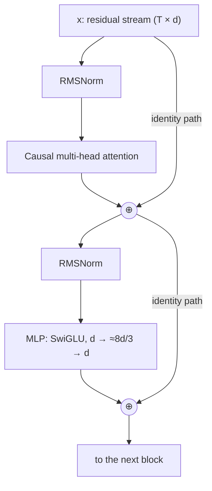

# Inside one transformer block

A decoder-only language model turns tokens into vectors of width $d$ (the **residual stream**), passes them through $L$ identical blocks, and maps the final vectors to next-token logits. Each block reads from the stream and **adds** its result back:

```
x = x + Attention(Norm(x))
x = x + MLP(Norm(x))
```

This is the **pre-norm** layout used by nearly all current models. The additions keep an identity path from the output back to the embeddings, which is what lets gradients flow through dozens of layers.



*A pre-norm decoder block. Each sublayer reads a normalized copy of the residual stream and adds its result back, so the identity path runs unbroken from the output to the embeddings.*

**Self-attention**, for a sequence of $T$ vectors and one head of width $d_k$:

$$Q = XW_Q,\; K = XW_K,\; V = XW_V, \qquad \text{Attention}(Q, K, V) = \operatorname{softmax}\!\Big(\frac{QK^\top}{\sqrt{d_k}} + M\Big) V.$$

- $QK^\top$ scores every query against every key: a $T \times T$ matrix.
- Dividing by $\sqrt{d_k}$ keeps the scores' variance near 1 when $d_k$ grows, so the softmax doesn't saturate.
- The mask $M$ puts $-\infty$ above the diagonal in a decoder, so a token can't see the future.
- **Multi-head** attention runs $h$ heads of width $d / h$ in parallel and concatenates them before an output projection $W_O$.

**The MLP** expands each position to about $4d$ (or $\tfrac{8}{3}d$ with a gated unit), applies a nonlinearity and projects back. Current models use **SwiGLU**: $\text{MLP}(x) = W_2\big(\operatorname{SiLU}(W_1 x) \odot W_3 x\big)$. Attention mixes information *between* positions; the MLP transforms each position *on its own* and holds most of the parameters.

**Normalization.** **RMSNorm** rescales each vector by its root mean square, with a learned gain: $x / \sqrt{\text{mean}(x^2) + \epsilon} \cdot g$. It drops LayerNorm's mean subtraction and bias, is cheaper, and works as well.

**Costs.** A block has about $12d^2$ parameters ($4d^2$ in attention, $8d^2$ in a $4d$ MLP). Attention's score matrix costs $O(T^2 d)$ FLOPs and, if materialized, $O(T^2)$ memory per head, which is the problem **FlashAttention** solves by computing it in tiles that never leave on-chip memory.
