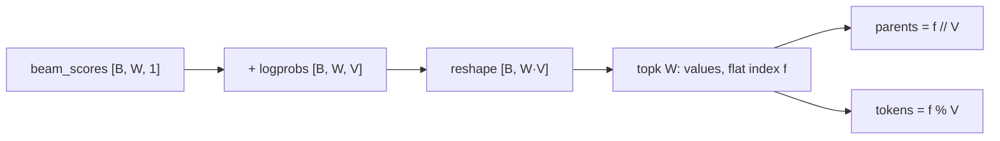

#### The idea
Each step has `W · V` candidates per input. Score them all with one broadcast add, flatten each input's candidates into
a row, and `topk` the row. The flat index encodes where a candidate came from: `f = w · V + t`, so `w = f // V` and
`t = f % V`.



After the step, the caller reorders its per-beam state (token history and KV cache) by `parents`: a beam that won two
slots is duplicated, and a beam that won none is dropped.

#### A solution
```python
import torch


def solve(beam_scores, logprobs):
    B, W, V = logprobs.shape
    candidates = (beam_scores[:, :, None] + logprobs).reshape(B, W * V)
    scores, flat = torch.topk(candidates, W, dim=-1)       # sorted, best first
    return scores, flat // V, flat % V
```

#### What it costs
One `[B, W·V]` add and a top-k: `O(B·W·V)` reads, memory-bound, a millisecond or so for the benchmark. The expensive
part of real beam search is elsewhere: `W` times the decode work per input, and reordering the KV cache by `parents`
each step (paged caches make that a block-table copy instead of a data copy). Production decoders also handle
finished beams (an end-of-sequence token moves a beam to a finished list), length normalisation (dividing by
`length^α`, since raw log-probabilities favour short outputs), and the first step, where all `W` beams are identical and
only beam 0 should be expanded.

#### Pitfalls
- Taking the top `W` tokens **per beam** and then the top `W` of those: correct, and two top-k calls instead of one.
- Using `flat % W` or `flat // W`: the divisor is the vocabulary size.
- Adding probabilities instead of log-probabilities (or multiplying log-probabilities).
- Looping over the batch in Python, as the reference does for clarity.
