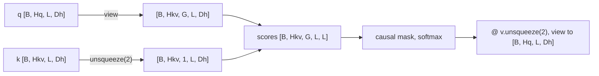

#### The idea
In GQA, consecutive query heads form a group that reads one shared key/value head. Group the query heads with a view
and let matmul broadcast the KV head across the group, so nothing is copied:



#### A solution
```python
import math

import torch


def solve(q, k, v):
    B, Hq, L, Dh = q.shape
    Hkv = k.shape[1]
    G = Hq // Hkv
    qg = q.view(B, Hkv, G, L, Dh)                                     # heads g·G .. g·G+G−1 share KV head g
    scores = qg @ k.unsqueeze(2).transpose(-2, -1) / math.sqrt(Dh)    # [B, Hkv, G, L, L], k broadcast over G
    future = torch.ones(L, L, dtype=torch.bool, device=q.device).triu(1)
    weights = torch.softmax(scores.masked_fill(future, float("-inf")), dim=-1)
    return (weights @ v.unsqueeze(2)).view(B, Hq, L, Dh)
```

`q.view` needs `q` contiguous; use `reshape` if it might not be.

#### What it costs
The FLOPs are the same as multi-head attention: GQA does not make the math cheaper. What it shrinks is the **KV cache**,
by the factor `G`. Llama-3-8B has 32 query heads and 8 KV heads, so its cache is 4 times smaller than full MHA, which
means 4 times more concurrent sequences per GPU, or 4 times less memory traffic per decode step, since decode reads the
whole cache once per token. `repeat_interleave` materialises `G` copies of K and V; in decode that throws the saving
away. Fused kernels (FlashAttention, FlashInfer) index the shared head directly.

#### Pitfalls
- Mapping query head `h` to KV head `h % Hkv` instead of `h // G`. Both are "a grouping", but checkpoints use the
  contiguous one.
- Building the mask on the CPU, so every call copies it to the GPU.
- Scaling by `√Hq` or by `Dh` instead of `√Dh`.
- Calling `scaled_dot_product_attention` with `enable_gqa=True` (that is the library doing the exercise).
