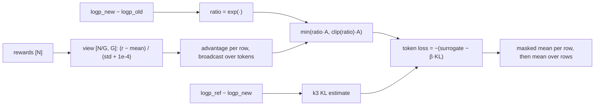

#### The idea
GRPO is PPO without a value network. Instead of a learned baseline, each completion's advantage is its reward measured
against the other completions **for the same prompt**: above the group mean is good, below is bad, scaled by the
group's spread. Everything else is PPO's per-token objective plus a KL penalty to the reference model.



#### A solution
```python
import torch


def solve(logp_new, logp_old, logp_ref, rewards, mask, group_size, clip_eps, beta):
    groups = rewards.view(-1, group_size)
    adv = ((groups - groups.mean(1, keepdim=True)) / (groups.std(1, keepdim=True) + 1e-4)).reshape(-1)

    ratio = torch.exp(logp_new - logp_old)
    a = adv[:, None]
    surrogate = torch.minimum(ratio * a, torch.clamp(ratio, 1 - clip_eps, 1 + clip_eps) * a)
    d = logp_ref - logp_new
    kl = torch.exp(d) - d - 1
    token_loss = torch.where(mask, -(surrogate - beta * kl), 0.0)
    row_loss = token_loss.sum(1) / mask.sum(1)
    return row_loss.mean(), adv
```

`torch.where` keeps padding out even if its values would overflow `exp`.

#### What it costs
Elementwise over `N × T`, memory-bound and cheap. The cost of GRPO is the sampling: `G` completions per prompt
(8 to 64), and the policy and reference forward passes over all of them. Dropping the value model saves a full copy of
the network in memory, which is why GRPO became the default for RL with verifiable rewards (math answers checked
exactly, code checked by tests). Variants adjust the normalisation: Dr. GRPO drops the per-group std and the per-row
length mean (both bias toward short or easy answers), and DAPO uses one token-level mean over the whole batch.

#### Pitfalls
- `.mean()` over all `N × T` positions, which counts padding.
- Population std (`G` in the denominator) instead of `G − 1`.
- `max` instead of `min` in the surrogate: clipping must make the objective **pessimistic** in both directions.
- Using `exp(logp_new − logp_ref)` for the KL term: the k3 estimator is `e^{ref−new} − (ref − new) − 1`, which is never
  negative.
- Normalising advantages over the whole batch instead of per group.
