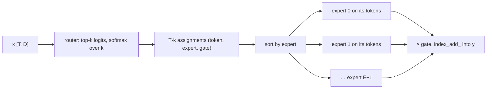

#### The idea
An MoE layer is three steps: **route**, **dispatch**, **combine**.



Each expert sees one dense batch of exactly the tokens routed to it, so the work is `top_k` expert MLPs per token, not
`E`. Sorting the flat assignment list by expert puts each expert's tokens in one contiguous slice.

#### A solution
```python
import torch


def solve(x, router_w, w_gate, w_up, w_down, top_k):
    T = x.shape[0]
    val, idx = torch.topk(x @ router_w.T, top_k, dim=-1)
    gates = torch.softmax(val, dim=-1)

    flat_expert = idx.reshape(-1)                                    # [T·k]
    order = torch.argsort(flat_expert)
    token = torch.arange(T, device=x.device).repeat_interleave(top_k)[order]
    gate = gates.reshape(-1)[order]
    counts = torch.bincount(flat_expert, minlength=router_w.shape[0]).tolist()

    y = torch.zeros_like(x)
    start = 0
    for e, n in enumerate(counts):
        if n:
            t = token[start:start + n]
            v = x[t]                                                 # gather this expert's tokens
            g = v @ w_gate[e].T
            h = (g * torch.sigmoid(g) * (v @ w_up[e].T)) @ w_down[e].T
            y.index_add_(0, t, h * gate[start:start + n, None])     # scatter-add, weighted
        start += n
    return y
```

`counts.tolist()` is one device-to-host sync per call; it is what lets each expert's matmul have a known size.

#### What it costs
Compute is `top_k / E` of a dense layer with the same parameters: Mixtral (8 experts, top-2) runs 13B active parameters
out of 47B. Memory is the opposite: all experts must be resident. At small batch every expert's weights are read for a
handful of tokens, so decode is memory-bound and MoE serving leans on **expert parallelism** (experts on different
GPUs, tokens exchanged with all-to-all). Production kernels replace the Python loop with one **grouped GEMM** over all
experts (the GPU gym's `moe_matmul`), and training adds a load-balancing loss and a capacity factor so no expert is
flooded.

#### Pitfalls
- Softmax over all `E` logits and then picking the top `k`: the gates no longer sum to 1 (Switch and Mixtral differ
  here; this spec renormalises over the chosen experts).
- Running every expert on every token and masking: right answer, `E / k` times the FLOPs.
- `y[t] += h` with repeated indices: fancy-index assignment drops duplicates when a token appears twice; use
  `index_add_`.
- Forgetting experts that receive no tokens, so an empty matmul or an indexing error appears.
