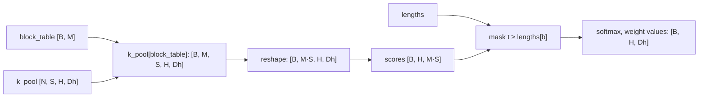

#### The idea
The block table is an indirection, exactly like a page table. Gather each sequence's physical blocks into logical
order with one advanced-indexing call, flatten (block, slot) into a token index, and from there it is the ordinary
masked decode step: scores against every gathered slot, `-inf` past `lengths[b]`, softmax, weighted values.



#### A solution
```python
import math

import torch


def solve(q, k_pool, v_pool, block_table, lengths):
    B, M = block_table.shape
    _, S, H, Dh = k_pool.shape
    keys = k_pool[block_table].reshape(B, M * S, H, Dh)        # logical order, padding blocks included
    values = v_pool[block_table].reshape(B, M * S, H, Dh)
    scores = torch.einsum("bhd,bthd->bht", q, keys) / math.sqrt(Dh)
    past = torch.arange(M * S, device=q.device)[None, :] >= lengths[:, None]   # [B, M·S]
    scores = scores.masked_fill(past[:, None, :], float("-inf"))
    return torch.einsum("bht,bthd->bhd", torch.softmax(scores, dim=-1), values)
```

Every sequence has at least one token, so no row is all `-inf`.

#### What it costs
This version copies `B·M·S·H·Dh` keys and values out of the pool (the gather), then reads them again; a paged-attention
kernel (vLLM, FlashInfer) instead loads each block straight from the pool inside the attention loop, so the cache is
read once. Either way decode is memory-bound: the time is bytes of KV read divided by bandwidth.

What paging buys is **capacity**. A contiguous cache must reserve `max_len` slots per sequence up front; with paging,
waste is at most one partly filled block per sequence (under 4% for 16-token blocks and 400-token replies, against
50 to 80% in the pre-vLLM systems the vLLM paper measured). Blocks can also be **shared**: sequences with the same
system prompt point at the same prefix blocks (prefix caching), and beam search or parallel sampling forks a sequence
by copying its block table, not its cache, copying a block only when one fork writes to it.

#### Pitfalls
- Trusting padding entries: they point at block 0, which holds another sequence's tokens, so only the length mask
  keeps them out.
- Masking `t > lengths[b]` instead of `t >= lengths[b]`.
- A Python loop over sequences (the reference does this for clarity): correct, and `B` rounds of small kernels.
- Assuming a sequence's blocks are consecutive or increasing in the pool.
