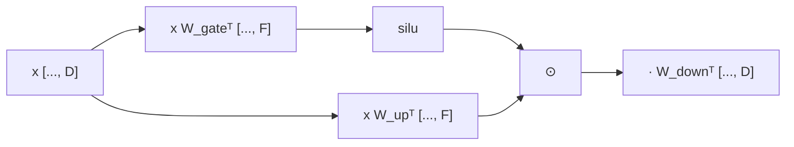

#### The idea
A GLU-style MLP replaces `relu(x W₁) W₂` with a **gated** hidden layer: one projection decides how much of the other
gets through. With SiLU as the gate, the hidden activation is `silu(x W_g) ⊙ (x W_u)`.



The gate and up projections read the same input, so stack their weights and do one matmul.

#### A solution
```python
import torch


def solve(x, w_gate, w_up, w_down):
    gate, up = (x @ torch.cat([w_gate, w_up]).T).chunk(2, dim=-1)   # one [2F, D] matmul
    return (gate * torch.sigmoid(gate) * up) @ w_down.T
```

`torch.cat` copies the weights every call; a real model stores the stacked `[2F, D]` weight once.

#### What it costs
Three matmuls of `D × F`: `6·N·D·F` FLOPs for `N` tokens, about two thirds of a transformer layer's parameters and
FLOPs. Llama sets `F ≈ 8D/3` (rounded to a multiple of 256) so the three-matrix block has the same parameter count as
a classic `4D` two-matrix MLP. In inference at small batch, the block is memory-bound: it reads `3·D·F` weights to
process a few tokens. The elementwise gate is cheap but, unfused, writes and reads two `[N, F]` tensors; a fused kernel
(the GPU gym's `swiglu`) or `torch.compile` removes that traffic.

#### Pitfalls
- `x @ w_gate` without the transpose: the weights are `[out, in]`, as in `nn.Linear`.
- Gating the wrong projection (`gate * silu(up)`), which gives a different function.
- `z / (1 + exp(-z))` overflowing for large negative `z`.
- Two separate matmuls are correct, just slower; the benchmark shows the difference only at large `N`.
