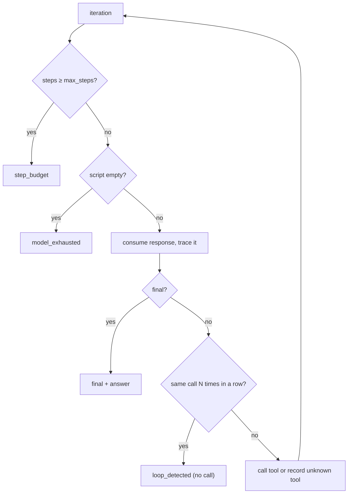

#### The idea
An agent loop needs guardrails, because a model can repeat itself forever. Check the stop conditions at the top of each
iteration in a fixed order, then handle the response:



Loop detection is a streak counter: compare `(tool, args)` with the previous proposal; equal increments the streak,
different resets it to 1.

#### A solution
```python
def solve(script, tools, max_steps, loop_limit):
    trace = []
    index = 0
    steps = 0
    previous = None
    streak = 0
    while True:
        if steps >= max_steps:
            return {"answer": None, "stop_reason": "step_budget", "trace": trace}
        if index >= len(script):
            return {"answer": None, "stop_reason": "model_exhausted", "trace": trace}
        response = script[index]
        index += 1
        steps += 1
        trace.append({"kind": "model", "response": response})
        if response["type"] == "final":
            return {"answer": response["answer"], "stop_reason": "final", "trace": trace}
        tool, args = response["tool"], response["args"]
        proposal = (tool, args)
        if proposal == previous:
            streak += 1
        else:
            previous = proposal
            streak = 1
        if streak >= loop_limit:
            return {"answer": None, "stop_reason": "loop_detected", "trace": trace}
        if tool not in tools:
            trace.append({
                "kind": "observation",
                "tool": tool,
                "ok": False,
                "error": f"unknown tool: {tool}",
            })
            continue
        try:
            output = tools[tool](**args)
        except Exception as exc:
            trace.append({
                "kind": "observation",
                "tool": tool,
                "ok": False,
                "error": f"{type(exc).__name__}: {exc}",
            })
        else:
            trace.append({"kind": "observation", "tool": tool, "ok": True, "output": output})
```

#### What it costs
`O(max_steps)` iterations plus the tool calls. Real loops add a wall-clock budget and a token budget, feed each
observation back to the model, and treat a tool error as information (the model can correct itself) rather than a
reason to stop.

#### Pitfalls
- Checking the step budget after consuming a response, which lets one extra response through.
- Calling the tool on the proposal that trips the loop detector.
- Resetting the streak on an unknown tool.
- Letting a tool exception escape the loop.
- Comparing args with `is` or by JSON string, so key order matters.
