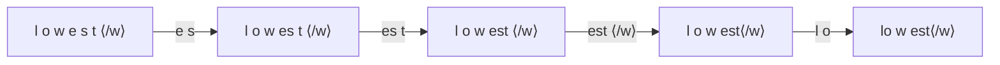

#### The idea
BPE builds a vocabulary bottom-up. Start with characters, then repeatedly merge the most frequent adjacent pair into
a new symbol. Work on **distinct** words with their counts, not the raw corpus, so a word seen 1,000 times is scanned
once and weighted by 1,000.

Encoding a new word replays the merges in the order they were learned. The order matters: a later merge may only apply
because an earlier one created its parts.



(`⟨/w⟩` stands for the end-of-word symbol `</w>`.)

#### A solution
```python
from collections import Counter

END = "</w>"


def _apply(symbols, pair):
    merged, i = [], 0
    while i < len(symbols):
        if i + 1 < len(symbols) and symbols[i] == pair[0] and symbols[i + 1] == pair[1]:
            merged.append(pair[0] + pair[1])
            i += 2
        else:
            merged.append(symbols[i])
            i += 1
    return merged


def solve(corpus, num_merges, words):
    if num_merges < 0:
        raise ValueError("num_merges must be >= 0")
    freq = Counter(corpus)
    split = {word: list(word) + [END] for word in freq}
    merges = []
    for _ in range(num_merges):
        pairs = Counter()
        for word, symbols in split.items():
            for pair in zip(symbols, symbols[1:]):
                pairs[pair] += freq[word]
        if not pairs:
            break
        best = min(pairs, key=lambda p: (-pairs[p], p))  # most frequent, then smallest pair
        merges.append(best)
        split = {word: _apply(symbols, best) for word, symbols in split.items()}

    encodings = []
    for word in words:
        symbols = list(word) + [END]
        for pair in merges:
            symbols = _apply(symbols, pair)
        encodings.append(symbols)
    return merges, encodings
```

`min(pairs, key=lambda p: (-pairs[p], p))` is "highest count, then smallest pair" in one expression.

#### What it costs
Each merge recounts every pair: `O(merges · total symbols in distinct words)`. That is fine for thousands of merges on
a small corpus. Production tokenizers keep pair counts incrementally (only words containing the merged pair change)
and a heap of pairs, which is the algo gym's `bpe_train`. Encoding with a list of merges is `O(merges · len(word))`;
real encoders instead rank merges and repeatedly apply the best-ranked pair present.

#### Pitfalls
- Counting the raw corpus instead of distinct words times frequency (same answer, much slower).
- Overlapping replacements: `a a a` merged with `(a, a)` must become `aa a`, not `aa aa`.
- Breaking ties by insertion order of a dict instead of the stated rule.
- Applying merges to new words in frequency order instead of learned order.
