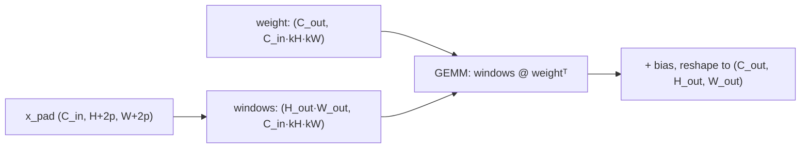

#### The idea
Each output pixel is a dot product between one filter and one window of the padded input. The direct loop over
`(c, i, j)` is the clearest version and is fine here. The production version is **im2col**: copy every window into a
row of a matrix, then do one matrix multiply against the flattened filters. That turns convolution into GEMM, the
operation hardware is fastest at.



#### A solution
```python
import numpy as np
from numpy.lib.stride_tricks import sliding_window_view


def _is_int(value):
    return isinstance(value, (int, np.integer)) and not isinstance(value, bool)


def solve(x, weight, bias, stride, padding):
    image = np.asarray(x, dtype=np.float64)
    kernel = np.asarray(weight, dtype=np.float64)
    offset = np.asarray(bias, dtype=np.float64)
    if image.ndim != 3 or kernel.ndim != 4 or offset.ndim != 1:
        raise ValueError("x is (C_in, H, W), weight is (C_out, C_in, kH, kW), bias is (C_out,)")
    c_in, h, w = image.shape
    c_out, k_c, k_h, k_w = kernel.shape
    if k_c != c_in or offset.shape != (c_out,) or k_h < 1 or k_w < 1:
        raise ValueError("channel counts and bias length must match the weight")
    if not _is_int(stride) or not _is_int(padding) or stride < 1 or padding < 0:
        raise ValueError("stride must be an integer >= 1 and padding an integer >= 0")
    out_h = (h + 2 * padding - k_h) // stride + 1
    out_w = (w + 2 * padding - k_w) // stride + 1
    if out_h < 1 or out_w < 1:
        raise ValueError("kernel does not fit in the padded image")

    padded = np.pad(image, ((0, 0), (padding, padding), (padding, padding)))
    # windows[ic, i, j, u, v] = padded[ic, i + u, j + v]; keep every stride-th start.
    windows = sliding_window_view(padded, (k_h, k_w), axis=(1, 2))[:, ::stride, ::stride][:, :out_h, :out_w]
    # Contract over (ic, u, v): this einsum is the im2col GEMM.
    return np.einsum("cijuv,ocuv->oij", windows, kernel) + offset[:, None, None]
```

`sliding_window_view` builds the windows as a strided **view**, without copying; `einsum` then does the multiply.

#### What it costs
`C_out · H_out · W_out · C_in · kH · kW` multiply-adds, whichever way you write it. im2col pays extra memory: the window
matrix is `kH·kW` times larger than the input. GPU libraries avoid that copy with implicit GEMM, and use Winograd or
FFT transforms for 3×3 and large filters.

#### Pitfalls
- Flipping the kernel: that is mathematical convolution, not what `conv2d` computes.
- Forgetting the floor in the output size, or computing it before padding.
- Padding the channel axis too.
- A four-deep Python loop over `c, i, j` and the window: right, and very slow for real images.
