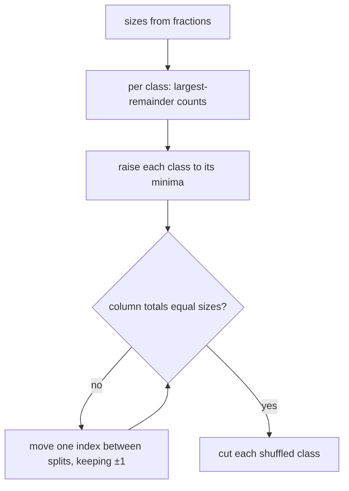

#### The idea
Without labels, it is one shuffle and two cuts. The work is in the sizes: floor each fraction's share, then hand out
the leftover slots in round-robin order so the lengths add up to `n`.

With labels, split each class separately so every split sees the class mix of the whole. For a class of size `c`, the
ideal count in split `s` is `c·sizes[s]/n`. Round those with the largest-remainder method, push each class up to its
minimum (1 in train for any class, one in validation for 2+, one everywhere for 3+), and then move single indices
between splits until the column totals equal `sizes` without breaking any class's ±1 bound. If no move fixes it, the
request is infeasible.



#### A solution
```python
import math
import random
from collections import defaultdict


def solve(n, fractions, labels, seed):
    sizes = _sizes(n, fractions)
    if labels is not None and len(labels) != n:
        raise ValueError("labels must have length n")
    rng = random.Random(seed)
    if labels is None:
        order = list(range(n))
        rng.shuffle(order)
        cut = sizes[0]
        mid = sizes[0] + sizes[1]
        parts = [order[:cut], order[cut:mid], order[mid:]]
    else:
        groups = defaultdict(list)
        for index, label in enumerate(labels):
            groups[label].append(index)
        ordered = sorted(groups)
        for label in ordered:
            rng.shuffle(groups[label])
        allocated = _allocate({label: len(groups[label]) for label in ordered}, sizes, n)
        if allocated is None:
            raise ValueError("these class sizes cannot meet the split rules")
        parts = [[], [], []]
        for label in ordered:
            start = 0
            for split, take in enumerate(allocated[label]):
                parts[split].extend(groups[label][start:start + take])
                start += take
    return {"train": parts[0], "validation": parts[1], "test": parts[2]}


def _sizes(n, fractions):
    if isinstance(n, bool) or not isinstance(n, int) or n < 0:
        raise ValueError("n must be a non-negative integer")
    if not isinstance(fractions, (list, tuple)) or len(fractions) != 3:
        raise ValueError("fractions must be three non-negative numbers")
    if any(isinstance(f, bool) or not isinstance(f, (int, float)) or f < 0 for f in fractions):
        raise ValueError("fractions must be three non-negative numbers")
    sizes = [math.floor(n * float(f) + 1e-12) for f in fractions]
    leftover = n - sum(sizes)
    if leftover < 0:
        raise ValueError("fractions are too large for n")
    for i in range(leftover):
        sizes[i % 3] += 1
    return sizes


def _minima(count):
    if count >= 3:
        return [1, 1, 1]
    if count == 2:
        return [1, 1, 0]
    if count == 1:
        return [1, 0, 0]
    return [0, 0, 0]


def _apportion(count, sizes, n):
    quotas = [count * size / n for size in sizes]
    counts = [int(math.floor(quota + 1e-12)) for quota in quotas]
    left = count - sum(counts)
    order = sorted(range(3), key=lambda i: (-(quotas[i] - counts[i]), i))
    for i in order[:left]:
        counts[i] += 1
    return counts


def _enforce_minima(counts, count, sizes, n):
    minima = _minima(count)
    targets = [count * sizes[s] / n for s in range(3)]
    counts = counts[:]
    for _ in range(6):
        if all(counts[s] >= minima[s] for s in range(3)):
            return counts
        needy = next(s for s in range(3) if counts[s] < minima[s])
        donors = sorted(range(3), key=lambda s: (counts[s] - targets[s], counts[s]), reverse=True)
        for donor in donors:
            if donor == needy or counts[donor] - 1 < minima[donor]:
                continue
            trial = counts[:]
            trial[donor] -= 1
            trial[needy] += 1
            if all(abs(trial[s] - targets[s]) <= 1 + 1e-9 for s in range(3)):
                counts = trial
                break
        else:
            return None
    return counts


def _allocate(class_sizes, sizes, n):
    if n == 0:
        return {}
    counts = {}
    for label, count in class_sizes.items():
        placed = _enforce_minima(_apportion(count, sizes, n), count, sizes, n)
        if placed is None:
            return None
        counts[label] = placed
    targets = {label: [class_sizes[label] * sizes[s] / n for s in range(3)] for label in class_sizes}

    def ok(label, trial):
        count = class_sizes[label]
        minima = _minima(count)
        return sum(trial) == count and all(
            trial[s] >= minima[s] and abs(trial[s] - count * sizes[s] / n) <= 1 + 1e-9 for s in range(3)
        )

    for _ in range(n + 5):
        used = [sum(counts[label][s] for label in class_sizes) for s in range(3)]
        if used == list(sizes):
            return counts
        moved = False
        for source in (s for s in range(3) if used[s] > sizes[s]):
            for dest in (s for s in range(3) if used[s] < sizes[s]):
                for label in sorted(class_sizes, key=lambda lab: counts[lab][source] - targets[lab][source], reverse=True):
                    trial = counts[label][:]
                    trial[source] -= 1
                    trial[dest] += 1
                    if ok(label, trial):
                        counts[label] = trial
                        moved = True
                        break
                if moved:
                    break
            if moved:
                break
        if not moved:
            return None
    return None
```

#### What it costs
`O(n)` for the shuffles plus a small repair loop over `K` classes and 3 splits. scikit-learn's
`StratifiedShuffleSplit` does the same kind of apportioning.

#### Pitfalls
- Splitting, then fitting preprocessing on all rows: the leak this exercise is named after (see the next two
  exercises).
- Rounding each split with `round()`: the three sizes may sum to `n ± 1`.
- Splitting rows that are not independent. If a user has many rows, or rows are ordered in time, split by user or by
  time instead; a random row split leaks the future or the same person into validation.
- Using the global random state, so the split changes between runs.
