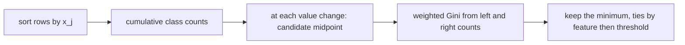

#### The idea
For each feature, sort the rows by that feature once. Every candidate threshold then splits the sorted order into a
prefix (left) and a suffix (right). Keep running class counts as you move rows from right to left, and the Gini of
each side is a formula over those counts. That turns the naive `O(N²)` per feature (re-counting both sides for every
threshold) into `O(N log N)` for the sort plus `O(N·C)` for the scan.



#### A solution
```python
import numpy as np

TIE_TOL = 1e-12


def solve(X, y):
    features = np.asarray(X, dtype=np.float64)
    labels = np.asarray(y)
    if features.ndim != 2 or labels.ndim != 1 or features.shape[0] != labels.shape[0]:
        raise ValueError("X must be N x D and y must have N labels")
    n, d = features.shape
    if n == 0 or d == 0:
        raise ValueError("X must have at least one row and one column")
    _, codes = np.unique(labels, return_inverse=True)
    onehot = np.eye(codes.max() + 1)[codes]                      # N x C
    total = onehot.sum(axis=0)
    parent = 1.0 - ((total / n) ** 2).sum()

    best = None  # (impurity, feature, threshold)
    for j in range(d):
        order = np.argsort(features[:, j], kind="stable")
        x = features[order, j]
        left = np.cumsum(onehot[order], axis=0)[:-1]             # counts with rows 0..i on the left
        n_left = np.arange(1, n)
        cut = x[1:] != x[:-1]                                    # only between distinct values
        if not cut.any():
            continue
        left, n_left = left[cut], n_left[cut]
        right, n_right = total - left, n - n_left
        gini_l = 1.0 - ((left / n_left[:, None]) ** 2).sum(axis=1)
        gini_r = 1.0 - ((right / n_right[:, None]) ** 2).sum(axis=1)
        score = (n_left * gini_l + n_right * gini_r) / n
        thresholds = (x[1:][cut] + x[:-1][cut]) / 2.0
        for impurity, threshold in zip(score, thresholds):       # increasing threshold order
            if best is None or impurity < best[0] - TIE_TOL:
                best = (float(impurity), j, float(threshold))
    if best is None or best[0] >= parent - TIE_TOL:
        return None
    return best[1], best[2], best[0]
```

#### What it costs
`O(D·N log N)` time and `O(N·C)` memory. A full tree repeats this at every node, so building it costs about
`O(D·N log N · depth)`. Gradient-boosting libraries (LightGBM, XGBoost's `hist`) go further: they bucket each feature
into ~256 bins once, so a split search is a histogram scan of 256 entries, not a sort.

#### Pitfalls
- Scoring by the unweighted average of the two sides' Gini: a split that peels off one pure row looks great.
- Using every value as a threshold instead of midpoints between **distinct** values, which creates empty sides.
- Returning a split that does not improve on the parent. Real trees stop there (or use a minimum gain).
- Comparing floats for ties with `==`: rounding differences between features change the winner.
