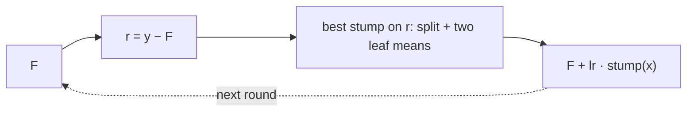

#### The idea
Gradient boosting fits each new weak learner to the **negative gradient** of the loss at the current predictions. For
squared loss `½(y − F)²` that gradient is just the residual `y − F`. So one step is: compute residuals, fit a
regression stump to them, and add a shrunken copy of the stump to `F`.



The best stump minimises the residual sum of squares around the two leaf means, which is the same as maximising the
variance reduction.

#### A solution
```python
import numpy as np


def solve(X, y, F, learning_rate):
    X = np.asarray(X, dtype=np.float64)
    residual = np.asarray(y, dtype=np.float64) - np.asarray(F, dtype=np.float64)

    candidates = []  # (sse, feature, threshold, left_mean, right_mean), in feature-then-threshold order
    for j in range(X.shape[1]):
        values = np.unique(X[:, j])  # sorted distinct values
        for t in (values[:-1] + values[1:]) / 2:
            left = X[:, j] <= t
            rl, rr = residual[left], residual[~left]
            sse = ((rl - rl.mean()) ** 2).sum() + ((rr - rr.mean()) ** 2).sum()
            candidates.append((sse, j, float(t), rl.mean(), rr.mean()))

    if not candidates:
        mean = float(residual.mean())
        feature, threshold, left_value, right_value = -1, 0.0, mean, mean
        update = np.full(len(residual), mean)
    else:
        best = min(c[0] for c in candidates)
        _, feature, threshold, left_value, right_value = next(c for c in candidates if c[0] <= best + 1e-9)
        update = np.where(X[:, feature] <= threshold, left_value, right_value)

    F_new = np.asarray(F, dtype=np.float64) + learning_rate * update
    return feature, threshold, float(left_value), float(right_value), F_new
```

#### What it costs
This scan recomputes both sides for every threshold: `O(D·N²)`. Sorting each feature once and keeping running sums of
`r` and `r²` brings it to `O(D·N log N)`, and histogram binning (LightGBM, XGBoost `hist`) to `O(D·N)` per tree plus
`O(D·bins)` per split. A full model repeats this for hundreds of rounds, each with a deeper tree.

#### Pitfalls
- Fitting the stump to `y` instead of the residual, or to `F − y` (the sign flips and the model walks away).
- Forgetting the learning rate on the update; shrinkage is what makes boosting generalise.
- Leaf values that are means of `y` instead of means of the residuals.
- No fallback when every feature is constant.
