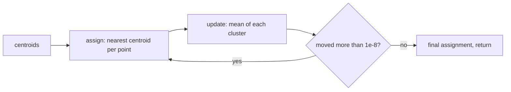

#### The idea
Lloyd's algorithm alternates two steps, each of which can only lower the within-cluster sum of squares:



Assignment is a vectorised distance matrix plus `argmin`, which already returns the lowest index on a tie. The update
uses a boolean mask per cluster, and a cluster with no members keeps its centroid instead of becoming `nan`.

#### A solution
```python
import numpy as np


def solve(X, centroids, max_iter):
    points = np.asarray(X, dtype=np.float64)
    centers = np.asarray(centroids, dtype=np.float64).copy()
    if points.ndim != 2 or centers.ndim != 2 or points.shape[1] != centers.shape[1]:
        raise ValueError("X is N x D and centroids is K x D")
    if points.shape[0] == 0 or centers.shape[0] == 0:
        raise ValueError("need at least one point and one centroid")
    if not _is_int(max_iter) or max_iter < 0:
        raise ValueError("max_iter must be an integer >= 0")

    for _ in range(int(max_iter)):
        labels = _assign(points, centers)
        updated = centers.copy()
        for cluster in range(len(centers)):
            members = points[labels == cluster]
            if len(members):
                updated[cluster] = members.mean(axis=0)
        if np.max(np.abs(updated - centers)) <= 1e-8:
            centers = updated
            break
        centers = updated
    return centers, _assign(points, centers)


def _assign(points, centers):
    # argmin keeps the lowest centroid index when squared distances tie.
    distance = ((points[:, None, :] - centers[None, :, :]) ** 2).sum(axis=2)
    return np.argmin(distance, axis=1)


def _is_int(value):
    return isinstance(value, (int, np.integer)) and not isinstance(value, bool)
```

#### What it costs
Each round is `O(N·K·D)` for the distances and the same memory for the `N × K × D` broadcast in this version. For large
data, use the `‖x‖² + ‖c‖² − 2x·c` expansion to keep memory at `O(N·K)`. Lloyd's algorithm converges in a finite number
of rounds, but only to a local optimum, and the result depends on initialisation: that is what k-means++ (pick each
new seed with probability proportional to its squared distance from the nearest chosen one) and several restarts fix.

#### Pitfalls
- `members.mean(axis=0)` on an empty cluster: a `nan` centroid that then poisons every later distance.
- Not assigning once more after the last update, so the labels describe the previous centroids.
- Checking convergence on the labels only: the centroids can still move after the labels stop changing.
- Mutating the caller's `centroids` list in place.
