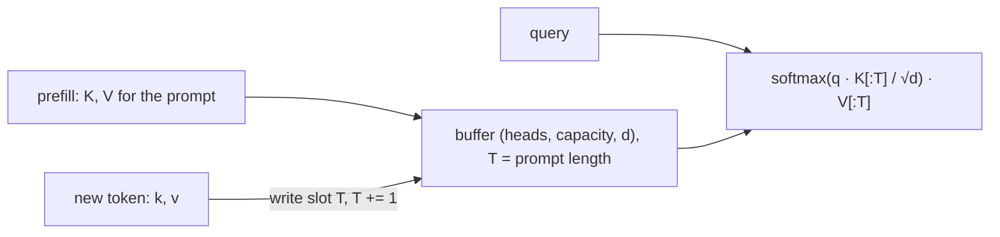

#### The idea
During decoding, every new token attends to every previous token's key and value. Recomputing them each step costs
`O(T)` matmuls per token; caching them makes each step one query against stored rows. Preallocate the whole
`(heads, capacity, d)` buffer once and keep a fill counter `T`. Appends write one slot, and reads slice `[:T]`.



#### A solution
```python
import numpy as np


class KVCache:
    def __init__(self, capacity):
        if isinstance(capacity, bool) or not isinstance(capacity, int) or capacity <= 0:
            raise ValueError("capacity must be a positive int")
        self.capacity = capacity
        self.k = self.v = None  # allocated on the first write, when heads and d are known
        self.t = 0

    def _allocate(self, heads, dim):
        self.k = np.zeros((heads, self.capacity, dim))
        self.v = np.zeros((heads, self.capacity, dim))

    def prefill(self, K, V):
        keys, values = np.asarray(K, dtype=np.float64), np.asarray(V, dtype=np.float64)
        if self.t or keys.ndim != 3 or keys.shape != values.shape:
            raise ValueError("prefill needs an empty cache and K, V of shape (heads, T, d)")
        heads, steps, dim = keys.shape
        if heads < 1 or dim < 1 or not 1 <= steps <= self.capacity:
            raise ValueError("prefill exceeds capacity or is empty")
        self._allocate(heads, dim)
        self.k[:, :steps], self.v[:, :steps] = keys, values
        self.t = steps

    def append(self, k, v):
        key, value = np.asarray(k, dtype=np.float64), np.asarray(v, dtype=np.float64)
        if key.ndim != 2 or key.shape != value.shape or min(key.shape) < 1:
            raise ValueError("k and v must share shape (heads, d)")
        if self.t == 0:
            self._allocate(*key.shape)
        elif key.shape != (self.k.shape[0], self.k.shape[2]):
            raise ValueError("k and v must match the cache heads and d")
        if self.t + 1 > self.capacity:
            raise ValueError("capacity exceeded")
        self.k[:, self.t], self.v[:, self.t] = key, value
        self.t += 1

    def get(self):
        if self.t == 0:
            raise ValueError("empty cache")
        return self.k[:, :self.t].copy(), self.v[:, :self.t].copy()

    def attention(self, query):
        if self.t == 0:
            raise ValueError("empty cache")
        q = np.asarray(query, dtype=np.float64)
        heads, _, dim = self.k.shape
        if q.shape != (heads, dim):
            raise ValueError("query must have shape (heads, d)")
        keys, values = self.k[:, :self.t], self.v[:, :self.t]
        scores = np.einsum("hd,htd->ht", q, keys) / np.sqrt(dim)
        weights = np.exp(scores - scores.max(axis=-1, keepdims=True))
        weights /= weights.sum(axis=-1, keepdims=True)
        return np.einsum("ht,htd->hd", weights, values)

    @staticmethod
    def memory_bytes(layers, heads, dim, seq, batch, dtype):
        if any(isinstance(n, bool) or not isinstance(n, int) or n < 0 for n in (layers, heads, dim, seq, batch)):
            raise ValueError("sizes must be non-negative ints")
        try:
            itemsize = np.dtype(dtype).itemsize
        except TypeError:
            raise ValueError(f"unknown dtype {dtype!r}") from None
        return 2 * layers * heads * dim * seq * batch * int(itemsize)
```

#### What it costs
Each append is `O(heads·d)` and each attention call `O(heads·T·d)`. Growing the arrays with `np.concatenate` instead
copies the whole cache on every token, `O(T²)` over a generation. Memory is the formula in `memory_bytes`: Llama-3-8B
(32 layers, 8 KV heads, head dim 128, bf16) holds 128 KiB per token, so a 32k-token context is 4 GiB for one sequence.
That is why serving systems page the cache (vLLM), share prefixes, quantise it to FP8, and use GQA.

#### Pitfalls
- Returning the whole preallocated buffer from `get()`, zeros included, or attending over the empty slots.
- Forgetting the factor 2 (keys **and** values) in the memory formula.
- Returning views into the buffer from `get()`, so a later append changes what the caller holds.
- Softmax without subtracting the max: scores of `1e6` overflow.
