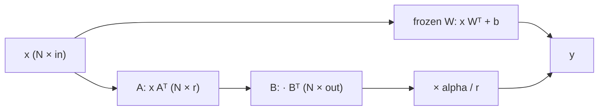

#### The idea
LoRA freezes `W` and learns a low-rank update `ΔW = s·BA`, with `A` of shape `r × in` and `B` of shape `out × r`.
In the forward pass, never build `BA`: compute `(x Aᵀ) Bᵀ`, two thin matmuls through an `r`-wide bottleneck. To
deploy, fold the update into the weight once, `W + s·BA`, and the adapter costs nothing at inference.



#### A solution
```python
import numpy as np


def solve(x, W, b, A, B, alpha):
    x, W, b, A, B = (np.asarray(v, dtype=np.float64) for v in (x, W, b, A, B))
    if x.ndim != 2 or W.ndim != 2 or A.ndim != 2 or B.ndim != 2 or b.ndim != 1:
        raise ValueError("x, W, A, B must be 2-D and b 1-D")
    out_f, in_f = W.shape
    r = A.shape[0]
    if r < 1 or x.shape[1] != in_f or b.shape[0] != out_f or A.shape[1] != in_f or B.shape != (out_f, r):
        raise ValueError("inconsistent shapes")
    scale = alpha / r
    y = x @ W.T + b + scale * ((x @ A.T) @ B.T)
    W_merged = W + scale * (B @ A)
    return y, W_merged, r * (in_f + out_f), out_f * in_f
```

#### What it costs
The adapter path costs `N·r·(in + out)` multiplies against `N·in·out` for the frozen layer: for `in = out = 4096` and
`r = 8`, under 0.4% extra. Building `BA` first costs `out·in·r` regardless of `N`, which only pays off when you merge.
Memory is where LoRA wins: optimizer state (Adam's two moments) exists only for `A` and `B`. `B` is initialised to zero,
so training starts exactly at the pretrained model.

#### Pitfalls
- Scaling by `alpha` instead of `alpha / r`, which makes the effective learning rate change with the rank.
- Forming `B @ A` in the forward pass of every step.
- Shape mistakes: `A` maps `in → r`, `B` maps `r → out`, so `ΔW = B @ A`, not `A @ B`.
- Counting biases in the parameter totals.
