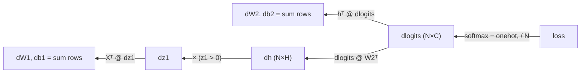

#### The idea
Backpropagation is the chain rule applied layer by layer, from the loss back. Keep what the forward pass produced
(`z1`, `h`, the log-probabilities) and walk the graph in reverse:



Two facts carry most of the work: the gradient of mean cross-entropy over softmax is `(softmax − onehot) / N`, and
ReLU passes the gradient through where its input was positive and blocks it elsewhere. Each gradient has its
parameter's shape, which is a quick check on every transpose.

#### A solution
```python
import numpy as np


def solve(X, y, W1, b1, W2, b2):
    X = np.asarray(X, dtype=np.float64)
    y = np.asarray(y, dtype=np.int64)
    W1, b1, W2, b2 = (np.asarray(a, dtype=np.float64) for a in (W1, b1, W2, b2))
    n = X.shape[0]

    # Forward, keeping what the backward pass needs.
    z1 = X @ W1 + b1
    h = np.maximum(z1, 0.0)
    logits = h @ W2 + b2
    shifted = logits - logits.max(axis=1, keepdims=True)
    log_probs = shifted - np.log(np.exp(shifted).sum(axis=1, keepdims=True))
    loss = float(-log_probs[np.arange(n), y].mean())

    # Backward.
    dlogits = np.exp(log_probs)
    dlogits[np.arange(n), y] -= 1.0
    dlogits /= n
    dW2 = h.T @ dlogits
    db2 = dlogits.sum(axis=0)
    dh = dlogits @ W2.T
    dz1 = dh * (z1 > 0)  # ReLU'(0) = 0
    dW1 = X.T @ dz1
    db1 = dz1.sum(axis=0)
    return loss, dW1, db1, dW2, db2
```

#### What it costs
The backward pass costs about twice the forward: each matmul `A @ B` in the forward needs two in the backward (one for
each input's gradient). Memory is the activations you kept, `O(N·(H + C))` here, which is what activation
checkpointing trades for recomputation in big models.

#### Pitfalls
- Forgetting the `1/N`: gradients are `N` times too large.
- `ReLU'(0) = 1`: harmless in practice, wrong against this spec.
- Computing softmax without subtracting the max: logits in the thousands overflow.
- Shape bugs: `db1` must be `(H,)`, so sum `dz1` over the batch axis, not the hidden one.
- Checking the result only by eye. A finite-difference check on a few entries catches sign and transpose errors fast.
