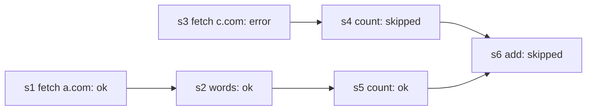

#### The idea
Separate the two phases, as a compiler does:

1. **Validate the whole plan** before any side effect: size limit, unique ids, and every `$id.output` reference pointing
   at an **earlier** step. With references only allowed backwards, the plan is a DAG in topological order already, and
   cycles are impossible.
2. **Execute in order**, keeping each step's status and output. A step whose references are not all `"ok"` is skipped
   with the list of blockers; independent steps still run.

The plan from the statement, as a dependency graph:



References are found by a recursive walk over strings, lists and dicts, and matched with `fullmatch` so a reference
inside a longer string stays a literal.

#### A solution
```python
import re

REF = re.compile(r"\$([A-Za-z0-9_]+)\.output")


def refs(value):
    """Ids referenced anywhere inside value, in order of appearance."""
    if isinstance(value, str):
        match = REF.fullmatch(value)
        return [match.group(1)] if match else []
    if isinstance(value, dict):
        return [r for v in value.values() for r in refs(v)]
    if isinstance(value, list):
        return [r for v in value for r in refs(v)]
    return []


def resolve(value, outputs):
    if isinstance(value, str):
        match = REF.fullmatch(value)
        return outputs[match.group(1)] if match else value
    if isinstance(value, dict):
        return {k: resolve(v, outputs) for k, v in value.items()}
    if isinstance(value, list):
        return [resolve(v, outputs) for v in value]
    return value


def solve(plan, tools, max_steps):
    if len(plan) > max_steps:
        raise ValueError(f"plan has {len(plan)} steps, the limit is {max_steps}")
    seen = set()
    for step in plan:
        if step["id"] in seen:
            raise ValueError(f"duplicate step id {step['id']!r}")
        missing = [r for r in refs(step["args"]) if r not in seen]
        if missing:
            raise ValueError(f"step {step['id']!r} references {missing[0]!r}, which is not an earlier step")
        seen.add(step["id"])

    trace, status, outputs = [], {}, {}
    for step in plan:
        entry = {"id": step["id"], "tool": step["tool"]}
        blocked = sorted({r for r in refs(step["args"]) if status[r] != "ok"})
        if blocked:
            entry.update(status="skipped", blocked_by=blocked)
        elif step["tool"] not in tools:
            entry.update(status="error", error=f"unknown tool: {step['tool']}")
        else:
            try:
                output = tools[step["tool"]](**resolve(step["args"], outputs))
                entry.update(status="ok", output=output)
                outputs[step["id"]] = output
            except Exception as exc:
                entry.update(status="error", error=f"{type(exc).__name__}: {exc}")
        status[step["id"]] = entry["status"]
        trace.append(entry)
    return trace
```

#### What it costs
`O(size of the plan's arguments)` for validation and resolution, plus the tool calls. Steps without a dependency path
between them could run in parallel; a scheduler would run every step whose references are all done, which is how
LLMCompiler-style executors cut latency.

#### Pitfalls
- Validating lazily, step by step, so the first few tools run before a bad reference is found.
- `re.search` instead of `re.fullmatch`, which treats `"total: $a.output"` as a reference.
- Skipping every step after a failure instead of only the ones that depend on it.
- Calling the tool for a skipped step (the tests record calls).
