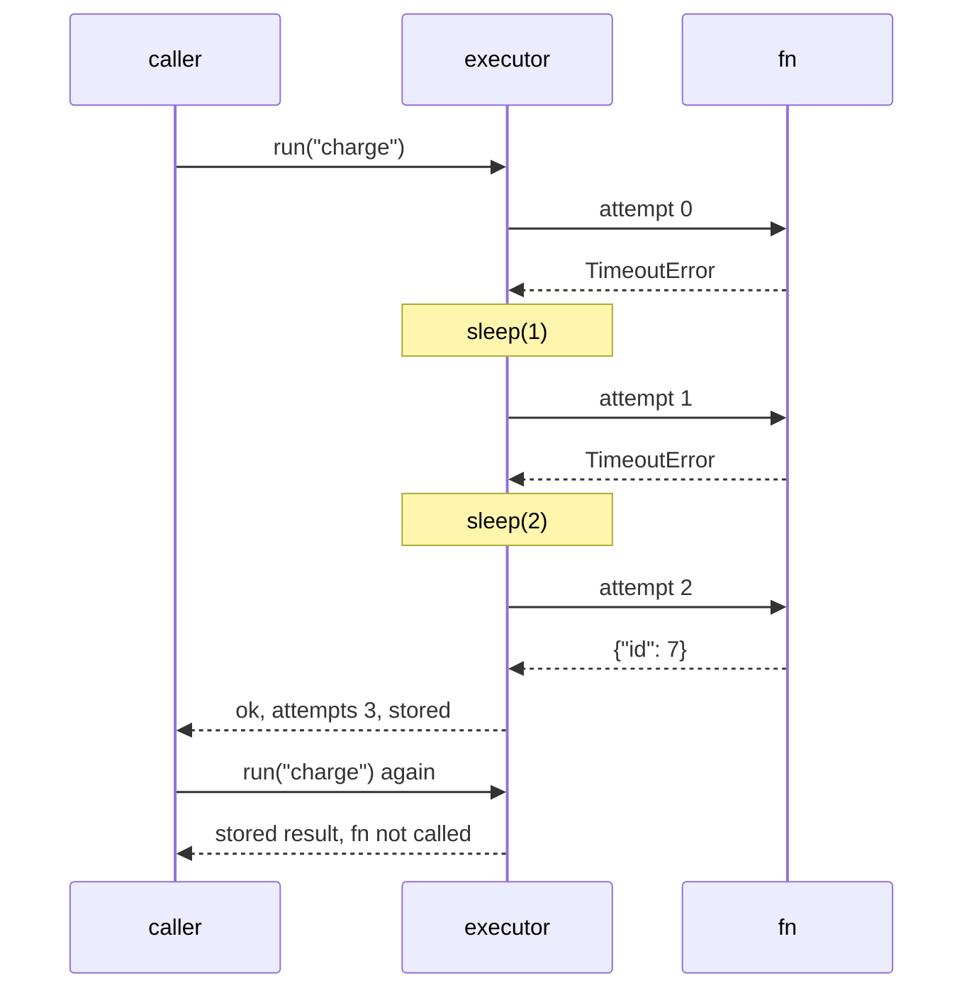

#### The idea
Two independent mechanisms:

- **Retry with capped exponential backoff.** On a transient error, wait `min(cap, base·2^i)` and try again, up to
  `max_attempts` calls. A permanent error stops at once, because retrying a `ValueError` only repeats it.
- **Idempotency.** Store the final result under the key. A repeat of the same key, which is what a client does when it
  never saw the first response, returns the stored result without running the operation again. That is how payment
  APIs make "charge" safe to retry.



#### A solution
```python
class IdempotentExecutor:
    def __init__(self, sleep, base, cap, max_attempts):
        self.sleep = sleep
        self.base = base
        self.cap = cap
        self.max_attempts = max_attempts
        self.stored = {}

    def run(self, key, fn, transient):
        if key in self.stored:
            return self.stored[key]
        delays = []
        for attempt in range(self.max_attempts):
            try:
                value = fn()
            except transient as exc:
                if attempt + 1 == self.max_attempts:
                    result = self._failure(exc, attempt + 1, delays)
                    self.stored[key] = result
                    return result
                delay = min(self.cap, self.base * 2 ** attempt)
                delays.append(delay)
                self.sleep(delay)
            except Exception as exc:
                result = self._failure(exc, attempt + 1, delays)
                self.stored[key] = result
                return result
            else:
                result = {"ok": True, "value": value, "attempts": attempt + 1, "delays": delays}
                self.stored[key] = result
                return result

    @staticmethod
    def _failure(exc, attempts, delays):
        return {
            "ok": False,
            "error": f"{type(exc).__name__}: {exc}",
            "attempts": attempts,
            "delays": delays,
        }
```

#### What it costs
At most `max_attempts` calls and the sum of the delays in waiting. Real systems add **jitter** (a random fraction of
each delay) so many clients that failed together do not retry together, and keep the idempotency store in a database
with a TTL, written in the same transaction as the side effect.

#### Pitfalls
- Sleeping after the last attempt, or after a permanent error.
- `except transient` written as `type(exc) == transient`, which does not retry subclasses.
- Storing only successful results, so a permanently failed key runs again.
- Off-by-one in the backoff exponent (the first delay is `base`, not `2·base`).
