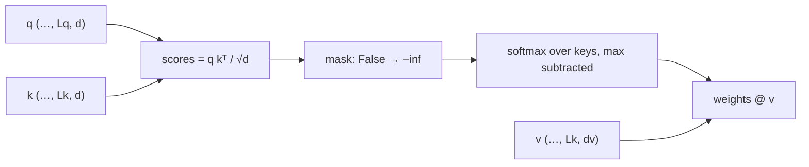

#### The idea
Attention is three matrix operations: scores `q kᵀ / √d_k`, a softmax over keys, and a weighted sum of values. Use
`np.swapaxes(k, -1, -2)` so any number of leading batch axes works, and apply the mask by writing `-inf` into the
scores **before** the softmax, so masked keys get `exp(-inf) = 0`.



The one edge case is a row where every key is masked: its max is `-inf`, and `-inf − (-inf)` is `nan`. Replace that
max with 0 and the divisor 0 with 1, and the row comes out as zeros.

#### A solution
```python
import numpy as np


def solve(q, k, v, mask=None):
    q, k, v = (np.asarray(a, dtype=np.float64) for a in (q, k, v))
    scores = q @ np.swapaxes(k, -1, -2) / np.sqrt(q.shape[-1])
    if mask is not None:
        scores = np.where(np.asarray(mask, dtype=bool), scores, -np.inf)
    row_max = scores.max(axis=-1, keepdims=True)
    row_max[~np.isfinite(row_max)] = 0.0  # fully masked rows: exp(-inf) = 0 everywhere
    e = np.exp(scores - row_max)
    total = e.sum(axis=-1, keepdims=True)
    weights = e / np.where(total == 0, 1.0, total)
    return weights @ v, weights
```

#### What it costs
`O(Lq·Lk·d)` time and `O(Lq·Lk)` memory per batch element for the score matrix. That quadratic memory is what
FlashAttention removes: it streams over key blocks with an online softmax and never stores the full matrix.

#### Pitfalls
- Scaling by `d_k` instead of `√d_k`, or by the value dimension.
- Masking after the softmax by zeroing weights: the remaining weights no longer sum to 1.
- Masking with a large negative number such as `-1e9`: fine in float32 usually, but with scores up to `1e6` it is not
  far enough, and in float16 it overflows.
- `k.T` on a batched array: it reverses **all** axes, not just the last two.
