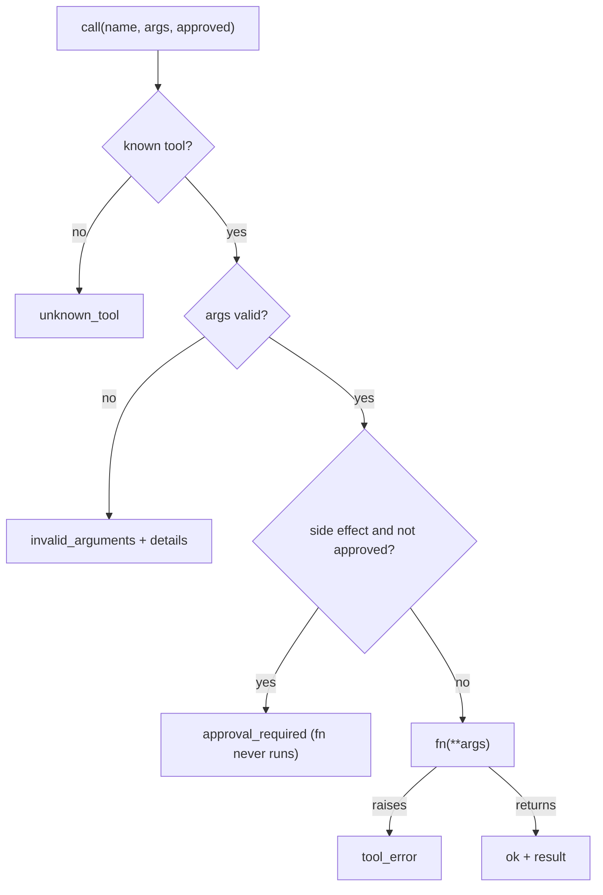

#### The idea
The registry is the trust boundary between a model and real side effects. Validate the tool at **registration** (using
`inspect.signature` to check the schema against the function's parameters), and validate each **call** in a fixed
order, returning a structured error instead of raising:



The approval check comes after validation, so a human is only asked to approve a call that could actually run.

#### A solution
```python
import inspect

ACCEPTS = {
    "string": {"string"},
    "integer": {"integer"},
    "number": {"integer", "number"},
    "boolean": {"boolean"},
    "array": {"array"},
    "object": {"object"},
}


def json_type(value):
    if value is None:
        return "null"
    if isinstance(value, bool):
        return "boolean"
    if isinstance(value, int):
        return "integer"
    if isinstance(value, float):
        return "number"
    if isinstance(value, str):
        return "string"
    if isinstance(value, list):
        return "array"
    if isinstance(value, dict):
        return "object"
    return type(value).__name__


class ToolRegistry:
    def __init__(self):
        self.tools = {}

    def register(self, name, fn, schema, side_effect=False):
        if name in self.tools:
            raise ValueError(f"tool {name!r} is already registered")
        params = inspect.signature(fn).parameters
        required = {p for p, info in params.items() if info.default is inspect.Parameter.empty}
        for arg, kind in schema.items():
            if arg not in params:
                raise ValueError(f"{name}: schema names {arg!r}, which is not a parameter")
            if kind not in ACCEPTS:
                raise ValueError(f"{name}: unknown type {kind!r} for {arg!r}")
        if required - set(schema):
            raise ValueError(f"{name}: required parameters missing from the schema: {sorted(required - set(schema))}")
        self.tools[name] = {"fn": fn, "schema": dict(schema), "required": required, "side_effect": side_effect}

    def _validate(self, tool, args):
        details = []
        for arg in sorted(set(args) | tool["required"]):
            if arg not in args:
                details.append(f"missing required argument: {arg}")
            elif arg not in tool["schema"]:
                details.append(f"unexpected argument: {arg}")
            elif json_type(args[arg]) not in ACCEPTS[tool["schema"][arg]]:
                details.append(f"{arg}: expected {tool['schema'][arg]}, got {json_type(args[arg])}")
        return details

    def call(self, name, args, approved=False):
        tool = self.tools.get(name)
        if tool is None:
            return {"ok": False, "error": "unknown_tool"}
        details = self._validate(tool, args)
        if details:
            return {"ok": False, "error": "invalid_arguments", "details": details}
        if tool["side_effect"] and not approved:
            return {"ok": False, "error": "approval_required"}
        try:
            result = tool["fn"](**args)
        except Exception as exc:
            return {"ok": False, "error": "tool_error", "message": f"{type(exc).__name__}: {exc}"}
        return {"ok": True, "result": result}
```

#### What it costs
`O(arguments)` per call. The design matters more than the cost: errors are data the agent loop can show the model,
and nothing a model writes can bypass the approval gate, since `fn` is only reached through `call`.

#### Pitfalls
- Running the function and then checking approval.
- Letting a tool exception escape and kill the agent loop.
- Required parameters computed from the schema instead of from the function's defaults.
- Accepting `bool` as `integer`.
