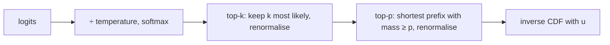

#### The idea
The steps are a pipeline over one probability vector, and the order matters:



A stable ranking (`np.lexsort` by `(-prob, index)`) gives the tie rule. The top-p cut is a `searchsorted` on the
cumulative sum of the sorted probabilities. Drawing with a supplied `u` makes the test deterministic: the token is the
first index whose cumulative probability exceeds `u`.

#### A solution
```python
import numpy as np


def solve(logits, temperature, k, p, u):
    logits = np.asarray(logits, dtype=np.float64)
    if logits.ndim != 1 or logits.size == 0:
        raise ValueError("logits must be a non-empty 1-D sequence")
    if isinstance(temperature, bool) or not isinstance(temperature, (int, float)):
        raise ValueError("temperature must be >= 0")
    if not np.isfinite(temperature) or temperature < 0:
        raise ValueError("temperature must be >= 0")
    if isinstance(k, bool) or not isinstance(k, int) or k <= 0:
        raise ValueError("k must be a positive int")
    if isinstance(p, bool) or not isinstance(p, (int, float)) or not np.isfinite(p) or p <= 0 or p > 1:
        raise ValueError("p must be in (0, 1]")
    if isinstance(u, bool) or not isinstance(u, (int, float)) or not np.isfinite(u) or u < 0 or u >= 1:
        raise ValueError("u must be in [0, 1)")

    vocab = int(logits.shape[0])
    if float(temperature) == 0.0:
        token = int(np.argmax(logits))
        probs = np.zeros(vocab, dtype=np.float64)
        probs[token] = 1.0
        return probs, token

    scaled = logits / float(temperature)
    scaled = scaled - np.max(scaled)
    exp = np.exp(scaled)
    probs = exp / np.sum(exp)

    def rank(weights):
        # Higher probability first. Equal probabilities keep the lower index first.
        return np.lexsort((np.arange(weights.shape[0]), -weights))

    chosen = rank(probs)[: min(k, vocab)]
    filtered = np.zeros(vocab, dtype=np.float64)
    filtered[chosen] = probs[chosen]
    filtered /= np.sum(filtered)

    order = rank(filtered)
    order = order[filtered[order] > 0.0]
    cumulative = np.cumsum(filtered[order])
    count = int(np.searchsorted(cumulative, float(p), side="left")) + 1
    count = min(max(count, 1), int(order.shape[0]))
    kept = order[:count]
    out = np.zeros(vocab, dtype=np.float64)
    out[kept] = filtered[kept]
    out /= np.sum(out)

    cdf = np.cumsum(out)
    token = int(np.searchsorted(cdf, float(u), side="right"))
    if token == vocab:
        token = int(np.flatnonzero(out)[-1])
    return out, token
```

#### What it costs
`O(V log V)` for the sorts. With a 128k vocabulary on a GPU, implementations avoid a full sort: they take a top-k with a
partial selection first, or (as in FlashInfer) do rejection sampling against a threshold so no sort is needed.

#### Pitfalls
- Dividing by a temperature of 0. Greedy decoding is a special case, not a limit you can compute.
- Applying top-p to the original softmax instead of the top-k-renormalised one.
- Keeping tokens while cumulative mass is `< p`, which drops the token that crosses `p`; the crossing token must be
  kept.
- `argsort` of `-probs` without a stable tie-break.
- Forgetting to renormalise after a filter.
