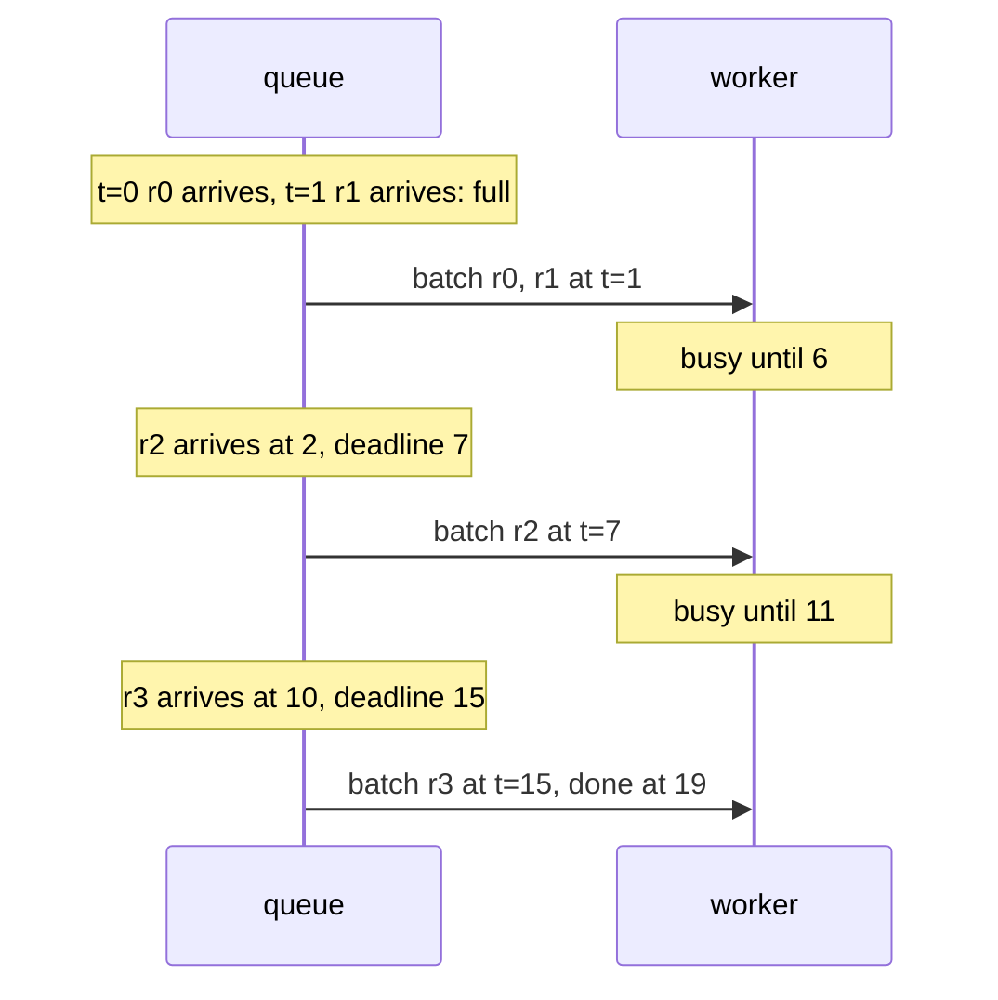

#### The idea
The batcher is a small discrete-event simulation. Everything follows from one rule for when the next batch starts:
the later of "the worker is free" and "the batch is ready", where ready means full or the oldest request's deadline.



#### A solution
```python
import math


def solve(arrivals, max_batch, max_wait, base_ms, per_item_ms):
    n = len(arrivals)
    latency = [0] * n
    i, free = 0, 0
    while i < n:
        oldest = arrivals[i]
        full = arrivals[i + max_batch - 1] if i + max_batch - 1 < n else math.inf
        start = max(free, oldest, min(full, oldest + max_wait))
        j = i
        while j < n and j - i < max_batch and arrivals[j] <= start:
            j += 1
        done = start + base_ms + per_item_ms * (j - i)
        for r in range(i, j):
            latency[r] = done - arrivals[r]
        free, i = done, j
    return latency
```

#### What it costs
`O(n)`: each request is taken once. The interesting part is the behaviour. With per-item cost `c` and base cost `b`, a
full batch serves `max_batch` requests in `b + c·max_batch` ms, so the server keeps up only while the arrival rate is
below `max_batch / (b + c·max_batch)` per ms; beyond that the queue grows without bound and latency explodes, which is
what admission control and autoscaling prevent. At low traffic, batches never fill and every request pays up to
`max_wait`. Triton Inference Server's `max_queue_delay_microseconds` and preferred batch sizes are exactly these knobs.

#### Pitfalls
- Waiting for the deadline even when the worker was busy past it: if requests piled up while it was busy, it should
  launch immediately.
- Including requests that arrive after `start` in the batch.
- Measuring latency from batch start instead of from arrival, which hides the queueing delay.
- An off-by-one in "the batch is full" (`i + max_batch − 1`, not `i + max_batch`).
