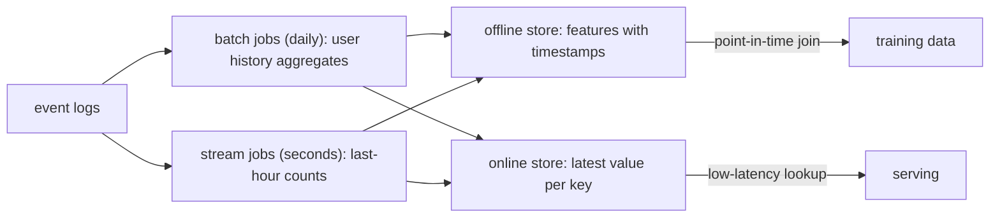

# Data and features for production models

Most production ML failures are data failures. Interviewers spend a lot of time here because it separates people who have shipped models from people who have trained them on clean datasets.

### Where labels come from

| Source | Example | Watch out for |
|---|---|---|
| **Implicit feedback** | clicks, watch time, purchases | position bias (top items get clicked because they are on top), clickbait, missing negatives |
| **Explicit feedback** | ratings, thumbs up, reports | sparse, and only some users give it |
| **Human labels** | moderators, annotators | cost, disagreement, labeller guidelines drift |
| **Delayed outcomes** | chargebacks, churn, conversions | arrive days or weeks later; recent data is mislabelled until they do |

An **impression that was not clicked** is the usual negative. Logging every impression with the model's score, the position and the features used is what makes training, debugging and counterfactual evaluation possible later.

### Negative sampling and recalibration

Clicks might be 1% of impressions, so teams often keep all positives and a fraction $w$ of negatives. The model then over-predicts. If it outputs $q$ on the sampled data, the calibrated probability is

$$p = \frac{q}{q + (1 - q)/w}$$

Calibration matters whenever the score is used as a probability: in an ads auction (bid × pCTR), in a threshold, or when several models' scores are combined.

### The feature pipeline

A **feature store** keeps both views of the same feature definitions: an **offline** store with history (every value with its timestamp) for building training sets, and an **online** store with the latest value per key for serving in milliseconds. Defining a feature once and materialising it to both is the main defence against **training/serving skew**: the model seeing differently computed features in production than in training.

### Point-in-time correctness

Training rows must use feature values **as they were when the event happened**, not as they are today. Joining today's "number of purchases" onto last month's events leaks the future into training: the model learns from information it will never have at prediction time, looks great offline, and disappoints online. The fix is a point-in-time (as-of) join: for each event, the latest feature value with a timestamp strictly before the event. The coding exercise in this track builds one.

> [!WARNING]
> Other common leaks: a feature computed from the label (for example "refund issued" when predicting fraud), random splits of time-ordered data (split by time instead), and the same user in train and test when you want to generalise to new users.

### Freshness

Batch features update daily, which is cheap; streaming features update in seconds and cost real infrastructure. Use streaming features where recency changes the answer: what a user did in this session, trending items, fraud velocity counts ("5 payments in the last minute").
