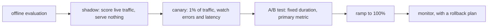

# From offline metrics to a safe launch

### Offline is necessary, not sufficient

Offline metrics (AUC, log loss, NDCG, recall@k) are cheap and fast, so you iterate on them. But they are computed on logged data the **old** system chose to show, they ignore how users react to new recommendations, and they rarely capture the business goal directly. A model ships only after an online experiment.

| Offline | Online |
|---|---|
| AUC, log loss, calibration | click-through rate, conversions |
| NDCG@k, recall@k | watch time, session length, retention |
| precision and recall at a threshold | fraud losses, false-decline rate, support tickets |

Pick one **primary** online metric, a few **secondary** ones, and **guardrails** that must not get worse (latency, crash rate, revenue, complaints).

### A/B tests

Users are randomly assigned to control or treatment, by a hash of the user id so each user stays in one arm. The test asks whether the difference in the primary metric is larger than chance would explain. For a conversion rate the sample size per arm is about

$$n = \frac{(z_{1-\alpha/2} + z_{1-\beta})^2 \, \big(p_1(1 - p_1) + p_2(1 - p_2)\big)}{(p_2 - p_1)^2}$$

with $z_{0.975} = 1.96$ for a 5% two-sided test and $z_{0.8} = 0.84$ for 80% power. Halving the effect you want to detect **quadruples** the sample size, which is why small improvements need large traffic or long tests.

> [!WARNING]
> Classic ways to fool yourself:
> - **Peeking**: checking every day and stopping at the first significant result inflates false positives. Fix the duration in advance or use a sequential test.
> - **Sample ratio mismatch (SRM)**: a 50/50 split that comes out 50.8/49.2 on millions of users means assignment or logging is broken. Check it with a chi-square test before reading any metric.
> - **Novelty and primacy effects**: users click new things because they are new. Run for at least one or two full weeks.
> - **Interference**: in marketplaces and social networks, treated users affect control users (shared inventory, messages). Randomise by region or cluster instead.

For rankers, **interleaving** (mixing two rankers' results in one list and counting which one's items get clicked) detects differences with far less traffic than an A/B test, and is often used to pre-screen candidates.

### Rolling out safely

**Shadow** mode catches crashes, latency problems and training/serving skew (compare its scores with offline predictions on the same requests) without any user impact.

### Monitoring and drift

After launch, watch three layers:

1. **System**: latency, error rate, throughput, cost.
2. **Data**: missing features, feature distributions against training, prediction distribution. The **population stability index** compares binned distributions: $\text{PSI} = \sum_i (a_i - e_i) \ln(a_i / e_i)$ over bins with baseline share $e_i$ and current share $a_i$. A common reading: below 0.1 stable, 0.1 to 0.25 a moderate shift, above 0.25 a major shift.
3. **Model quality**: the real metric once labels arrive (they may arrive days later), by segment.

Then decide how often to retrain: on a schedule (daily for fast-changing domains such as ads and feeds, weekly or monthly for slower ones), or when drift crosses a threshold.
