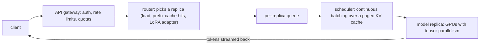

# LLM serving as a system

"Design the serving system for a chat model" is now a standard system design question. The GPU and ML systems interview course covers the kernels; this lesson is the system around them.

### The request path

A **replica** is one copy of the model, often spread over several GPUs with tensor parallelism. The **scheduler** decides every step which sequences run; it is where batching, memory and latency meet. Tokens are **streamed** to the client as they are generated.

### Two phases with opposite bottlenecks

- **Prefill** processes the prompt in one pass. Every weight read is reused for every prompt token, so it is **compute-bound**. It sets the **time to first token (TTFT)**.
- **Decode** generates one token per sequence per step. Each step reads **all weights** plus each sequence's KV cache for a handful of FLOPs, so it is **memory-bound**. It sets the **time per output token (TPOT)**, often called inter-token latency.

A lower bound on one decode step is the bytes it must read divided by memory bandwidth:

$$t_\text{step} \gtrsim \frac{\text{weight bytes} + \text{KV bytes of the batch}}{\text{aggregate HBM bandwidth}}$$

### KV-cache memory decides concurrency

Every layer stores a key and a value vector per token per KV head:

$$\text{KV bytes per token} = 2 \times \text{layers} \times \text{KV heads} \times \text{head dim} \times \text{bytes per value}$$

For a 70B model with 80 layers, 8 KV heads (grouped-query attention), head dimension 128 and BF16, that is 327,680 bytes, about a third of a megabyte **per token**. A 4,096-token conversation holds 1.34 GB. What is left of GPU memory after the weights, divided by that, is the number of sequences you can run at once, and therefore the batch size.

<figure class="diagram"><svg viewBox="0 0 600 120" width="600" role="img" aria-label="GPU memory split between weights, reserve and KV cache">
<rect x="20" y="30" width="262" height="40" class="d-c"/><text x="151" y="55" class="d-text" text-anchor="middle">weights 140 GB</text>
<rect x="282" y="30" width="38" height="40" class="d-fill"/><text x="301" y="55" class="d-text" text-anchor="middle">20</text>
<rect x="320" y="30" width="260" height="40" class="d-a"/><text x="450" y="55" class="d-text" text-anchor="middle">KV cache 160 GB: 119 × 4K-token sequences</text>
<text x="20" y="95" class="d-muted" text-anchor="start">Four 80 GB GPUs = 320 GB. The grey sliver is reserved for activations and the runtime.</text>
</svg>
<figcaption>KV memory, not compute, usually caps the batch. Quantising weights or the KV cache, or fewer KV heads, raises the cap.</figcaption></figure>

### Batching

| Strategy | How it works | Good for |
|---|---|---|
| **Static** | wait for a full batch, run it to the end | offline batch jobs |
| **Dynamic** | gather requests for up to `max_wait` ms or `max_batch` requests, then run | fixed-size models such as classifiers and embedders |
| **Continuous** | admit and retire sequences **every decode step** | LLM generation, where outputs differ in length |

Continuous batching (Orca, vLLM, TensorRT-LLM, SGLang) stops short replies from waiting for long ones. With a **paged KV cache**, memory is allocated in small blocks as sequences grow, so the scheduler can pack sequences densely and admit new ones as soon as blocks free up. The dynamic-batching exercise in this track simulates the trade-off a classic model server makes between waiting for a fuller batch and answering sooner.

### Throughput against latency

<figure class="diagram"><svg viewBox="0 0 560 220" width="560" role="img" aria-label="Throughput rises with batch size and flattens, while per-user latency grows">
<line x1="50" y1="190" x2="530" y2="190" class="d-line" marker-end="url(#d-arrow)"/>
<line x1="50" y1="190" x2="50" y2="20" class="d-line" marker-end="url(#d-arrow)"/>
<text x="290" y="212" class="d-muted" text-anchor="middle">batch size (concurrent sequences)</text>
<path d="M50,185 C120,110 200,60 330,45 S480,38 520,36" class="d-line" fill="none" stroke-width="2.5"/>
<path d="M50,170 C200,166 300,150 380,120 S470,60 520,30" class="d-line" fill="none" stroke-dasharray="6 4" stroke-width="2"/>
<text x="400" y="34" class="d-text" text-anchor="start">tokens/s (server)</text>
<text x="400" y="150" class="d-text" text-anchor="start">TPOT (per user)</text>
<line x1="300" y1="190" x2="300" y2="30" class="d-line" stroke-dasharray="2 4"/>
<text x="296" y="185" class="d-muted" text-anchor="end">SLO limit</text>
</svg>
<figcaption>While decode is memory-bound, adding sequences costs almost nothing per step, so throughput climbs. Past the ridge point, or when the KV reads dominate, each step slows. Pick the largest batch that still meets the TPOT target.</figcaption></figure>

Service-level objectives are written per phase: for example **TTFT p95 under 500 ms** and **TPOT p95 under 50 ms** (20 tokens per second per user, faster than people read). Throughput and cost come from running the largest batch that meets them.

### What a million tokens costs

$$\text{cost per million output tokens} = \frac{\text{GPU cost per hour for one replica}}{\text{tokens per second} \times 3600 / 10^6}$$

Four GPUs at $2.50 an hour serving 4,000 tokens per second cost about $0.69 per million output tokens. Doubling throughput at the same latency halves the cost, which is why batching, quantisation and caching matter so much.

### The levers

| Lever | What it improves | Cost |
|---|---|---|
| Continuous batching + paged KV cache | throughput, memory utilisation | scheduler complexity |
| Quantisation (FP8, int8, int4 weights; FP8 KV cache) | memory, decode speed, cost | some quality risk; needs evaluation |
| Prefix caching | TTFT for shared system prompts and multi-turn chats | memory for cached blocks; cache-aware routing |
| Chunked prefill | TPOT stability when long prompts arrive | slightly higher TTFT for the long prompt |
| Speculative decoding | per-user latency at small batch | draft model compute; helps less at large batch |
| Disaggregated prefill and decode pools | meets TTFT and TPOT targets independently | KV transfer between pools |
| Tensor parallelism | fits big models, cuts per-step latency | communication; fewer replicas per GPU count |
| Multi-LoRA serving | many fine-tuned variants on one base model | adapter batching kernels |
| Autoscaling on queue depth | cost at low traffic | cold starts take minutes (weights to load) |

> [!TIP]
> A strong answer moves in this order: memory (weights, then KV per sequence, then how many sequences fit), then latency (step time from bandwidth, against the TPOT target), then throughput and cost, then the levers that relax whichever constraint binds.
