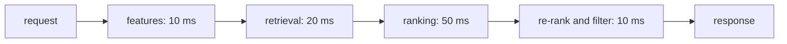

# Numbers every design needs

Estimates turn a design from a sketch into an engineering plan. You need about five kinds, and each is one line of arithmetic.

### Requests per second

$$\text{average QPS} = \frac{\text{daily active users} \times \text{requests per user per day}}{86{,}400}$$

A day has 86,400 seconds; round it to ${10^5}$ for speed. Traffic is not flat: plan for a **peak** of 2 to 3 times the average, and size for the peak.

### Storage and memory

Multiply count by size, and keep units honest:

- An embedding table: rows × dimension × bytes per number. 500 million users with 64-dimensional float32 embeddings is ${5 \times 10^8 \times 64 \times 4 = 128}$ GB: too big for one server's RAM in most fleets, so it is sharded or quantised.
- Logs: events per day × bytes per event × retention.

### Compute

A model's cost per prediction is roughly **2 × parameters** FLOPs for dense layers (one multiply and one add per weight). Multiply by predictions per second for the total, then divide by what one accelerator sustains (often 30 to 50% of its peak).

### Latency budgets

A user-facing request has a budget, often 100 to 300 ms at p99, split across stages:

Write the budget per stage, then check each stage against it. If ranking 500 candidates must fit in 50 ms, the ranker is evaluated in batches, not one candidate at a time.

### Latency numbers to know

| Operation | Rough time |
|---|---|
| Read 1 MB sequentially from memory | 50 to 100 µs |
| Round trip inside a data centre | 0.5 ms |
| Key-value lookup in an in-memory cache (Redis) | under 1 ms |
| Read 1 MB from an SSD | about 1 ms |
| Round trip between continents | 100 to 150 ms |
| One decode step of a 70B LLM on fast GPUs | 10 to 50 ms |

> [!NOTE]
> Precision matters less than the order of magnitude. Interviewers want to see that you know a cross-continent call costs as much as a whole ranking stage, and that a 128 GB table does not fit in a 32 GB server.
