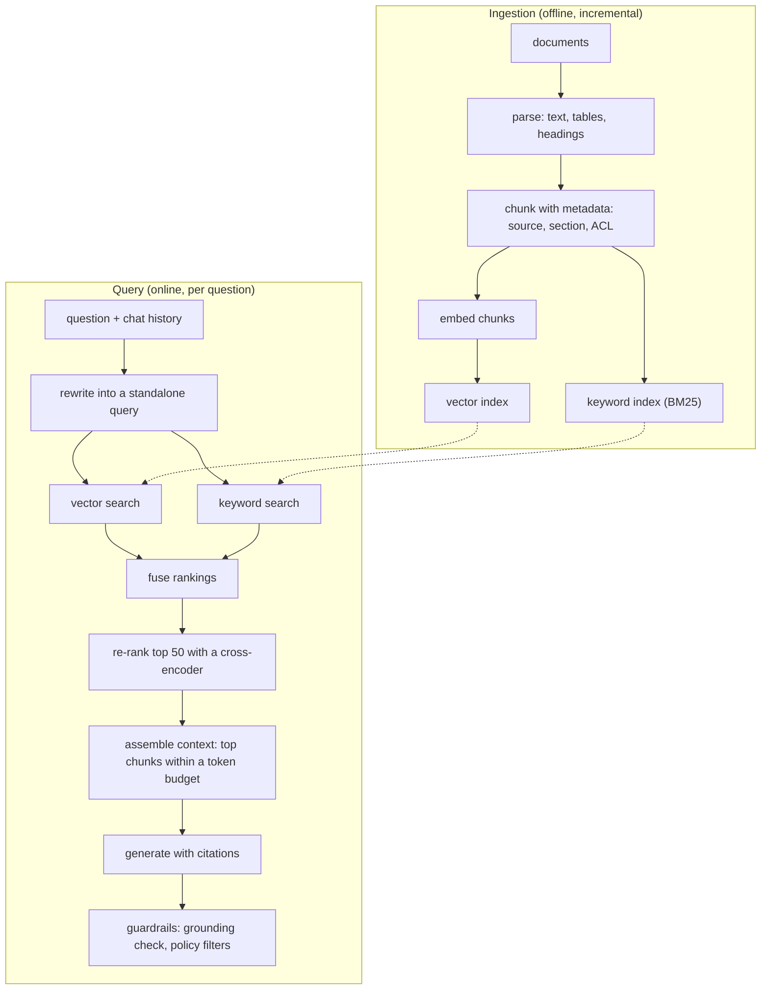

# Retrieval-augmented generation as a system

A model knows what was in its training data, up to a cutoff, and nothing about your company's documents. Retrieval-augmented generation (RAG) fetches relevant text at question time and puts it in the prompt. The design question is usually "build an assistant that answers questions over our documentation / tickets / contracts".

### Two pipelines

### Chunking

Chunks are the unit of retrieval. **Too small** (one sentence) and a chunk lacks context ("it" refers to what?); **too large** (whole documents) and the embedding blurs many topics, retrieval gets less precise, and you spend context on irrelevant text. A common start is 200 to 800 tokens with some overlap, split at headings and paragraphs, with the document title and section path prepended to each chunk. Keep metadata (source, date, owner, **access list**) with every chunk.

### Hybrid retrieval

Dense embeddings find paraphrases ("reset my password" matches "recover account access"); keyword search (BM25) finds exact identifiers, error codes and rare names that embeddings blur. Run both and **fuse** their rankings. Reciprocal rank fusion (the coding exercise) needs no score calibration between the two systems: it only uses ranks. A **cross-encoder re-ranker** then reads the question and each candidate chunk together, which is far more accurate than comparing two separate embeddings and affordable for the top 20 to 100.

### Grounding

Instruct the model to answer only from the provided context, to cite the chunks it used, and to say "I don't know" when the context does not contain the answer. Check citations automatically (does the cited chunk contain the claim?) for high-stakes domains.

### Evaluation

Evaluate the two halves separately, on a golden set of real questions with known answers and source documents:

| Stage | Metric | How |
|---|---|---|
| Retrieval | recall@k of the right chunk, MRR | labelled question-to-chunk pairs |
| Generation | faithfulness (claims supported by the context), answer correctness, relevance | human review, or an LLM judge calibrated against humans |
| End to end | resolution rate, thumbs up/down, escalations to humans | online |

If the right chunk is not retrieved, no prompt fixes the answer: measure retrieval first.

> [!WARNING]
> **Permissions belong in retrieval.** Filter chunks by the user's access rights inside the search query (metadata filters), before anything reaches the prompt. Asking the model not to reveal a document it has already been given is not access control. Prompt injection in retrieved documents ("ignore previous instructions…") is the other RAG-specific risk: treat retrieved text as data, and limit what tools the assistant can call.

### Cost and latency

Per question: an embedding call (cheap), two searches (milliseconds), a re-ranker pass (tens of milliseconds on a GPU), and one LLM call whose cost is dominated by **input tokens**: ten 500-token chunks is 5,000 tokens of context per question. Levers: fewer, better chunks after re-ranking; a smaller model for easy questions (routing); caching answers to frequent questions; and prompt caching of the fixed system prompt.
