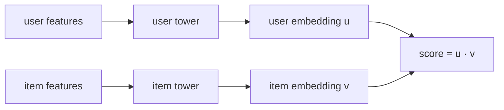

# The recommendation and search funnel

You cannot score a billion items with a heavy model in 200 ms. Every large recommendation, search and ads system is a **funnel**: each stage narrows the candidates and can afford a more expensive model per item.

<figure class="diagram"><svg viewBox="0 0 640 230" width="640" role="img" aria-label="Funnel from millions of items to the final ten">
<polygon points="20,20 620,20 540,70 100,70" class="d-a"/>
<text x="320" y="50" class="d-text" text-anchor="middle">Candidate generation: 10⁶–10⁹ items → ~1,000 (two-tower ANN, co-visitation, popular, followed)</text>
<polygon points="100,74 540,74 470,124 170,124" class="d-b"/>
<text x="320" y="104" class="d-text" text-anchor="middle">Light ranker: ~1,000 → ~200 (small model)</text>
<polygon points="170,128 470,128 410,178 230,178" class="d-c"/>
<text x="320" y="158" class="d-text" text-anchor="middle">Heavy ranker: ~200 → ordered list</text>
<polygon points="230,182 410,182 370,222 270,222" class="d-fill"/>
<text x="320" y="207" class="d-text" text-anchor="middle">Re-rank: diversity, rules → 10</text>
</svg>
<figcaption>Each stage trades recall for precision. Early stages must be cheap per item and keep good items; later stages can afford rich features and cross-features.</figcaption></figure>

### Candidate generation

Several **retrievers** each propose a few hundred items, and their union goes on: embedding retrieval, "items co-watched with what you just watched", trending items, items from creators you follow. The workhorse is the **two-tower model**:

The towers never see each other's inputs, so item embeddings can be precomputed for the whole catalogue and loaded into an **approximate nearest neighbour (ANN)** index (HNSW graphs, IVF with product quantisation). At request time you compute one user embedding and ask the index for the top few hundred dot products, in milliseconds. It is trained with **in-batch negatives**: the other items in a batch serve as negatives for each user (with a correction for popular items, which appear as negatives more often).

The price of that independence: a two-tower model cannot use **cross features** ("has this user watched this creator before?"), which are often the strongest signals. That is the ranker's job.

### Ranking

The ranker sees a few hundred candidates and can use everything: user features, item features, cross features, context (time, device), and sequence features (the last 50 items the user engaged with). Typical models: gradient-boosted trees for smaller systems, and deep models (wide-and-deep, DCN, DLRM-style embedding tables with MLPs, or transformers over the user's history) at scale. Production rankers are usually **multi-task**: one network predicts click, like, share, watch time and "not interested", and a value function combines them into one score.

### Re-ranking

The ranker scores items independently, so the top 10 can be ten near-duplicates. The final stage applies **diversity** (for example maximal marginal relevance, the second coding exercise), freshness boosts, business rules (no more than two items from one creator, remove items already seen), and policy filters.

### Biases and cold start

- **Position bias**: users click the top slot more whatever it holds. Log the position, train with it as a feature and set it to a constant at serving, or estimate propensities with a little randomisation.
- **Feedback loops**: the model only learns about items it chose to show. Reserve a small share of traffic for exploration.
- **Cold start**: new items have no engagement. Use content features (text, image embeddings), a boost for new items, or a bandit to explore them. New users get popularity and context-based recommendations until they have history.

### Ranking metrics

- **Recall@k** for retrieval: of the items the user engaged with, how many were in the top `k` candidates.
- **NDCG@k** for ranking: rewards relevant items near the top, with graded relevance. $\text{DCG@k} = \sum_{i=1}^{k} \frac{2^{rel_i} - 1}{\log_2(i + 1)}$, divided by the best possible DCG for that query.
- **MRR**: the average of ${1/\text{rank}}$ of the first relevant result; good when one answer matters (search, question answering).
- Online: click-through rate, watch time per session, retention, and guardrails (latency, complaints, creator diversity).
