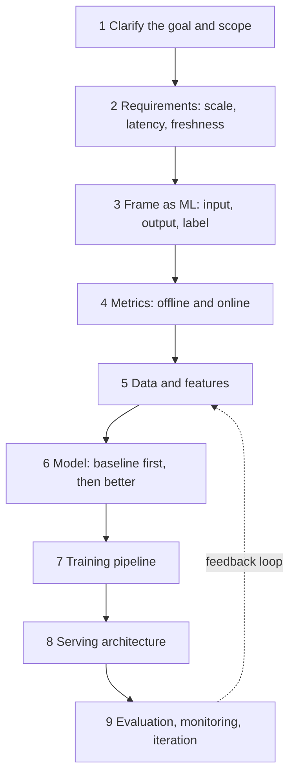

# How an ML system design interview works

An ML system design interview gives you a product goal ("recommend videos", "rank search results", "flag fraudulent payments", "serve a chat model to a million users") and 45 to 60 minutes. There is no single right design. The interviewer is checking whether you can turn a vague goal into a system that would actually work, and whether you see the trade-offs as you go.

### What is being graded

- **Problem framing.** Turning "increase engagement" into an ML task with a label, a prediction and a metric you can measure.
- **Data sense.** Where labels come from, how they are biased, what leaks, and what is available at prediction time.
- **Modelling judgment.** Picking a model that matches the data size, latency budget and stage of the system, and starting simple.
- **Systems thinking.** Latency, throughput, memory and cost, written as numbers, and an architecture that meets them.
- **Evaluation and iteration.** Offline metrics that predict online wins, an A/B test plan, monitoring, and what you would improve next.

### A framework that keeps you organised

You will not spend equal time on each box. A typical 45 minutes:

| Minutes | What you do |
|---|---|
| 0 to 5 | Clarify: users, scale, what success means, constraints. Write the requirements down. |
| 5 to 10 | Frame the ML problem and pick metrics. State the label precisely. |
| 10 to 20 | Data and features: sources, labels, leakage, freshness. |
| 20 to 30 | Model and training: a baseline, then the model you would ship, and why. |
| 30 to 40 | Serving: draw the request path with latency and QPS numbers. |
| 40 to 45 | Evaluation, A/B test, monitoring, failure modes, next steps. |

> [!TIP]
> Say your plan out loud in the first minute ("I'll clarify, frame it, then go data, model, serving, evaluation"). Interviewers often steer you toward the part they care about; a visible plan makes that easy and shows structure.

### Habits that score well

- **Numbers over adjectives.** "200 ms p99 for 500 candidates means under 0.4 ms per candidate if I score serially, so I batch them" beats "it needs to be fast".
- **Start with a baseline.** Logistic regression or a popularity ranker first, then say exactly what the bigger model buys.
- **Name the trade-off when you choose.** Freshness against cost, recall against latency, a bigger model against more replicas.
- **Close the loop.** Every design has a feedback loop (the model changes what users see, which changes the training data). Say how you handle it.

The tracks of this course follow the framework: numbers first, then data, ranking systems, evaluation, LLM serving, RAG, and finally complete worked designs.
