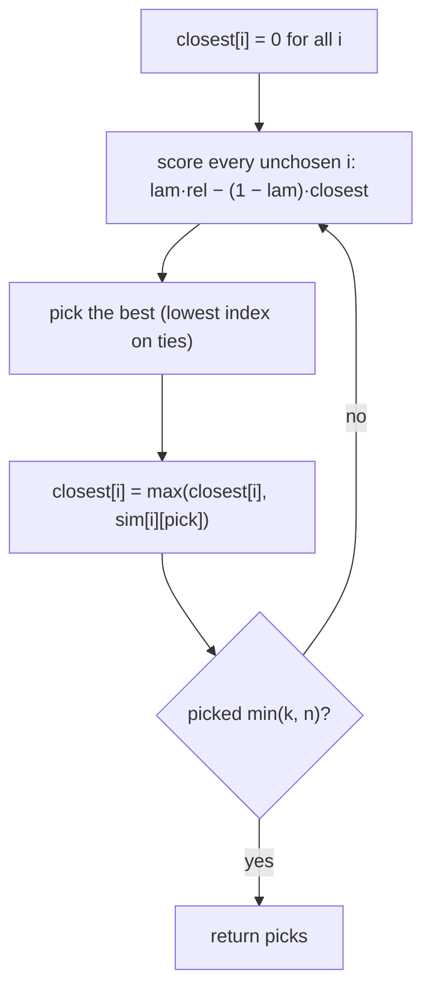

#### The idea
MMR is a greedy trade-off: each pick maximises relevance minus a penalty for resembling anything already picked. The
penalty uses the **closest** chosen item, so one near-duplicate in the list is enough to push a candidate down.



`lam = 1` is the ranker's order; `lam = 0` ignores relevance after the first pick and spreads out as much as possible.

#### A solution
```python
def solve(relevance, similarity, k, lam):
    n = len(relevance)
    closest = [0.0] * n            # max similarity to anything already chosen
    chosen, taken = [], [False] * n
    for _ in range(min(k, n)):
        best, best_score = -1, None
        for i in range(n):
            if taken[i]:
                continue
            score = lam * relevance[i] - (1 - lam) * closest[i]
            if best_score is None or score > best_score:
                best, best_score = i, score
        chosen.append(best)
        taken[best] = True
        for i in range(n):
            closest[i] = max(closest[i], similarity[i][best])
    return chosen
```

The running `closest` array is the important detail: recomputing the max over all chosen items for every candidate
would cost `O(n·k)` per step.

#### What it costs
`O(n·k)` time in total and `O(n)` memory besides the similarity matrix. Building that matrix from embeddings is
`O(n²·d)`: for `n = 1,000` and `d = 64`, 64 million multiply-adds per request, fine on a CPU in a few milliseconds but
worth avoiding by computing only the rows of chosen items (`k·n·d`). Determinantal point processes give a more
principled diversity objective at higher cost; many production systems combine MMR-style scoring with hard rules such
as "at most two items per creator in any window of five".

#### Pitfalls
- Using the **sum** or average of similarities instead of the max, which penalises a candidate for being mildly similar
  to many items rather than nearly identical to one.
- Forgetting that the first pick has no penalty (the max over an empty set is 0 here).
- Breaking ties by the highest index, or by relevance.
- Returning the picks sorted by index instead of in pick order.
