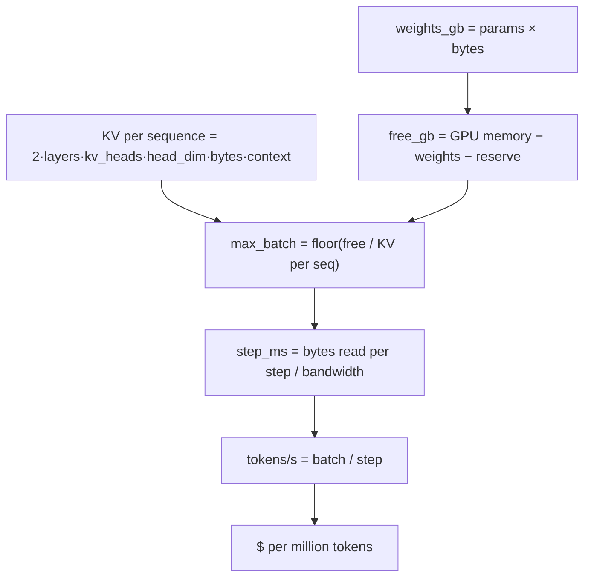

#### The idea
The function is the whiteboard estimate in order: memory, then time, then money.



Reading the outputs for the example: the batch is capped at 119 by memory, the step (22 ms) is well inside a 50 ms TPOT
target, and the KV reads (160 GB) cost more bandwidth per step than the weights (140 GB). That last fact is why long
contexts are expensive: past a few thousand tokens, decode time is dominated by the cache, not the model.

#### A solution
```python
import math


def solve(model, gpu, workload):
    weights_gb = model["params_b"] * model["weight_bytes"]
    kv_bytes_token = 2 * model["layers"] * model["kv_heads"] * model["head_dim"] * model["kv_bytes"]
    kv_gb_per_seq = kv_bytes_token * workload["context_tokens"] / 1e9
    free_gb = gpu["count"] * gpu["memory_gb"] - weights_gb - workload["reserve_gb"]
    max_batch = math.floor(free_gb / kv_gb_per_seq)
    if max_batch < 1:
        raise ValueError("the model does not fit with even one sequence")
    step_ms = (weights_gb + max_batch * kv_gb_per_seq) / (gpu["count"] * gpu["bandwidth_tbs"])
    tokens_per_s = max_batch * 1000 / step_ms
    return {
        "weights_gb": weights_gb,
        "kv_bytes_token": int(kv_bytes_token),
        "kv_gb_per_seq": kv_gb_per_seq,
        "max_batch": int(max_batch),
        "step_ms": step_ms,
        "tokens_per_s": tokens_per_s,
        "user_tokens_per_s": 1000 / step_ms,
        "cost_per_m": gpu["count"] * gpu["price_per_hour"] / (tokens_per_s * 3600 / 1e6),
    }
```

#### What it costs
Constant time. The value is in the comparisons it makes quick. FP8 weights and KV cache (the second test) free 70 GB
and halve the bytes per sequence: the batch grows from 119 to 342 and cost per million tokens falls from $0.52 to
$0.18. Without GQA (the last test) each sequence needs 8 times the memory, the batch collapses to 14, and cost per
token rises about eightfold, to $4.30. The model leaves out compute time (it matters once the batch is large enough to approach the ridge point),
tensor-parallel communication, prefill work, and the fact that real conversations are shorter than the context limit.
State those when you use it in an interview.

#### Pitfalls
- Forgetting the factor 2 for keys and values, or mixing GiB and GB.
- Per-GPU memory instead of the replica's total.
- Counting only weights in the step time: at large batch and long context the KV reads dominate.
- Treating the result as a prediction rather than a lower bound on step time and an upper bound on throughput.
